# PeroxIDE

**A complete RAD IDE for building GUI apps in Rust.** A drag-and-drop form
designer with real layouts, a full code editor, a debugger and project
management, all in one install with a pinned, tested Rust toolchain.
It also has a built-in MCP server, so AI agents can drive the IDE.

Targets: **milestone 1 is desktop: macOS, Linux and Windows.** Android comes later.
At that point the IDE itself will run on Android tablets and build installable APKs on
the device.

> Status: **Phases 1 to 4 are done; forms use [Slint](https://slint.dev)** ([ADR 0011](docs/adr/0011-slint-for-user-apps.md)).
> A real Rust IDE with rust-analyzer, a form designer for `.slint` files, a debugger, a
> Test Explorer, full git, and clippy and rustfmt built in. **File → New GUI App** gives
> you a native-looking window to design, a button wired to Rust code, an About dialog,
> and Run. Agents can drive all of it over MCP, down to screenshotting forms
> (`designer.screenshot`). See [docs/roadmap.md](docs/roadmap.md).

## Screenshots

**The form designer.** Your app's UI is plain `.slint`, drawn on the canvas by Slint
itself in the style your app will use (Cupertino on macOS, Fluent on Windows and Linux;
switch styles in the toolbar). Drag widgets from the palette; layouts work like Qt's. Edit
properties and events in the inspector. Every change is a small edit to the `.slint` text,
so Undo, the Source view and git diffs all agree, and hand-written Slint opens fine.


**Free placement, like VB or Qt without a layout.** In Slint, anything that isn't a layout
(a window, a `Rectangle`, a tab) places its children by `x`/`y`. Drop widgets anywhere on
the snap grid, move them, resize them with handles, nudge them with the arrow keys.
**Break layout** turns a layout into free placement without moving anything; **Lay out
vertically / horizontally / in a grid** goes back, ordering widgets by where they sit.


**Go to handler.** The arrow next to an event declares a callback on the window, wires the
widget to it, and adds a typed method to your `impl MainWindowHandlers` block, ready to
fill in. rust-analyzer completes the generated `get_*`/`set_*` accessors like any Rust code.


**Menus and non-visual components.** Drop a **MenuBar** on a window and build it from
the inspector: *Add menu*, *Add item*, *Add separator*, *Add submenu*. Click a shortcut
field and press the keys (⌘G is written as `@keys(Control + G)`, which is Ctrl+G on
Windows and Linux). An item's `activated` event goes to a handler like a button's
`clicked`. A **Timer** isn't drawn on the form, so it sits in the component tray under the
canvas, with the menu bar. On macOS the menu becomes the real menu bar at the top of the
screen.

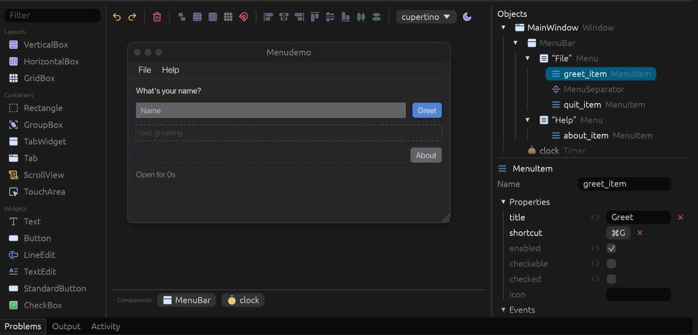

**Actions and toolbars.** A command used from a menu and a toolbar is an *action*: a
callback on the window, plus, if it can be switched off, an `in-out property <bool>
clear_enabled`. Select the window to list its actions and tick *can be disabled*. On a
menu, *Add item for…* adds a menu item that runs an action; on a toolbar (**ToolBar** in
the palette), *Add button for…* does the same with a button. In Rust,
`ui.set_clear_enabled(false)` greys out the menu item and the button together. It's all
plain Slint, so it works without PeroxIDE too.

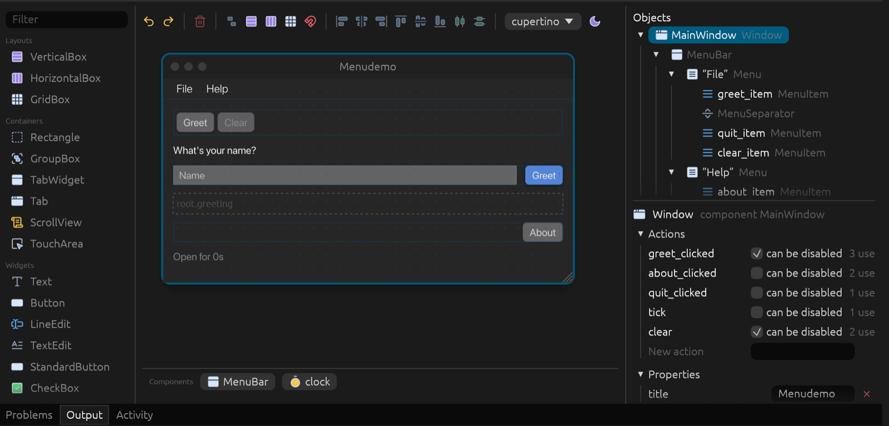

**Images and fonts.** An image or icon property offers the project's images, or *Choose
a file…*, which copies it into `ui/images/` and writes `@image-url("images/logo.png")`.
The palette lists the project's images too: drag one onto the form. A font property's
*Add a font file…* copies the font into `ui/fonts/`, adds `import "fonts/X.ttf";` and
picks its family. Slint builds them into the app, so nothing needs installing.

**App style and theme colours.** *App* in the designer's toolbar picks the style the app
is built with (each OS's own, or Fluent, Cupertino, Material, Cosmic everywhere) and
whether it follows the system's light or dark setting or always uses one. It's kept in
`ui/slint-project.json` and applied by the `build.rs` helper. Colour properties can use a
theme colour (`Palette.accent-background`, `Palette.foreground`…), which follows the style
and light or dark.

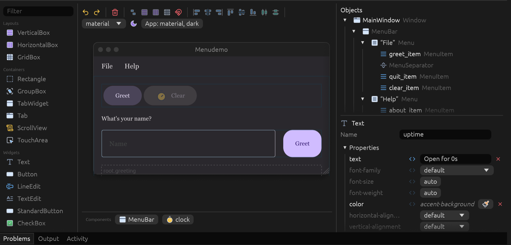

**Translations.** The globe next to a text property makes it translatable
(`@tr("Save")`); *Make all text translatable* does a whole form. *Translations…* shows
every string against each language in a table, saved as standard gettext `.po` files in
`ui/translations/`. The designer previews any language, the build bundles them all, and
the app starts in the system's language. Agents can do the same with `i18n.*`.

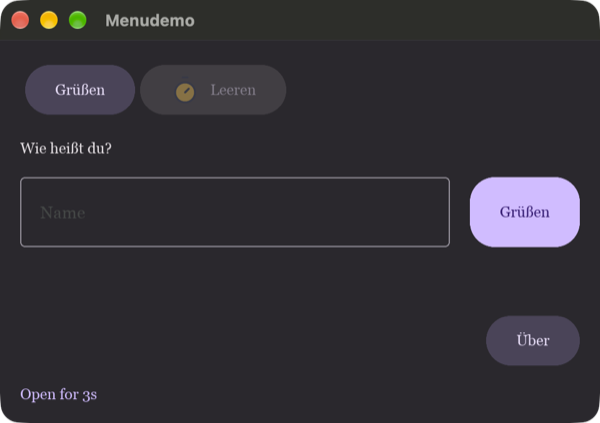

**Data-aware tables and lists.** Point the designer at a SQLite file, select a
`StandardTableView` (or a list or combo box), write a query and press *Bind*. The preview
shows the real rows and the columns come from the query. The build generates
`ui.load_people(&db)` for your code, which runs the query with
`perox_ui::data::Database` (sqlx) and fills the table. `perox_ui::data::Table` also turns
any rows of text into the models Slint's lists and tables take.

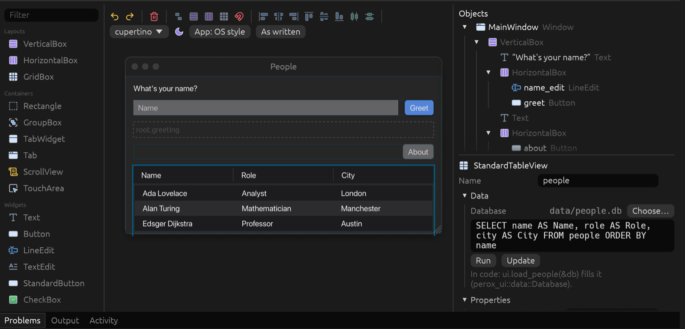

**Form inheritance.** File → New Inherited Form… makes a form that starts with everything
another one has (`component AdminWindow inherits MainWindow`) and adds to it. The designer
shows the base's parts as they are, lists them as inherited (they're edited in the base's
file), and lets you set the base's properties on the new form. Slint gives Rust only a
component's own properties and events, so the new form passes the base's on as
`base_name`, `base_greet_clicked`, and so on.

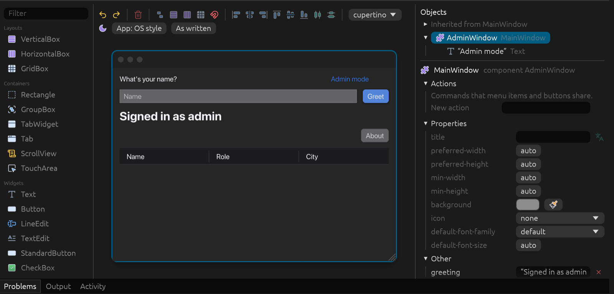

**Tab order.** The keyboard button in the designer's toolbar numbers the widgets in the
order Tab moves through them, which in Slint is the order of the `.slint` file. A selected
widget's *Tab order* row moves it earlier or later. In a freely placed window that changes
nothing on screen; in a layout the order *is* the layout, so the designer says so instead.

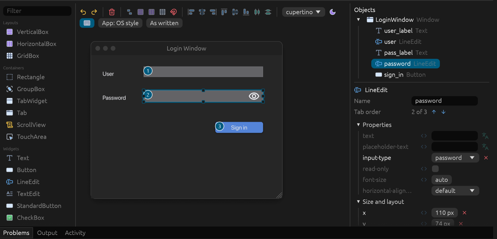

**Your own components and libraries.** File → New Component… makes a reusable part (like a
frame) in its own `.slint` file. The palette lists the project's components and those of
any `.slint` library the project uses (`library-paths` in `ui/slint-project.json`, imported
as `@name`). Drag one in and the import is added; the inspector shows the properties it
declares.

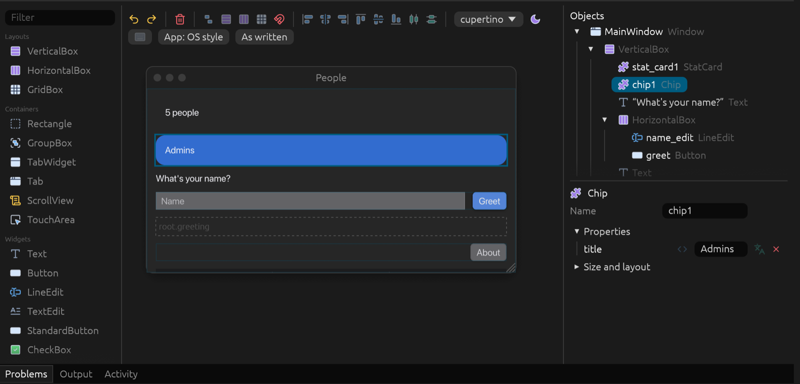

**Dialogs and message boxes.** File → New Dialog… adds a `.slint` dialog with OK and
Cancel; in Rust, `SettingsDialog::new()?.exec(Some(ui.window()), |result| …)` shows it.
For a quick question, `perox_ui::msgbox::confirm(ui, "Delete", "Delete this file?")`
shows the OS's own alert.

**What runs.** Real native windows. Left: [examples/word-counter](examples/word-counter).
Right: a new GUI app with a widget added in the designer.

<p>
  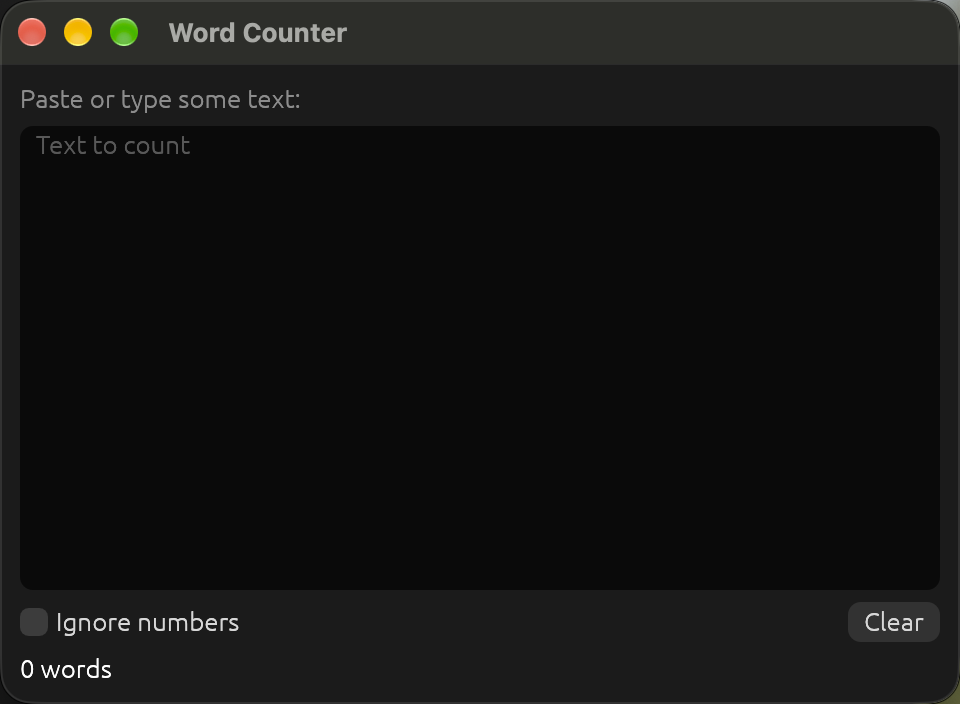
  
</p>

**Debugger.** Click left of a line number for a breakpoint, press F5. The program builds
and runs under lldb-dap; when it stops you get the line, the call stack (standard library
frames folded away), variables readable through Rust's own formatters, watches, and a
console for expressions. A panic stops where it happened. F10, F11 and Shift+F11 step;
any test can be debugged from the Test Explorer. macOS uses Xcode's lldb-dap; on Linux
install `lldb`, on Windows LLVM ([ADR 0012](docs/adr/0012-debugger.md)).

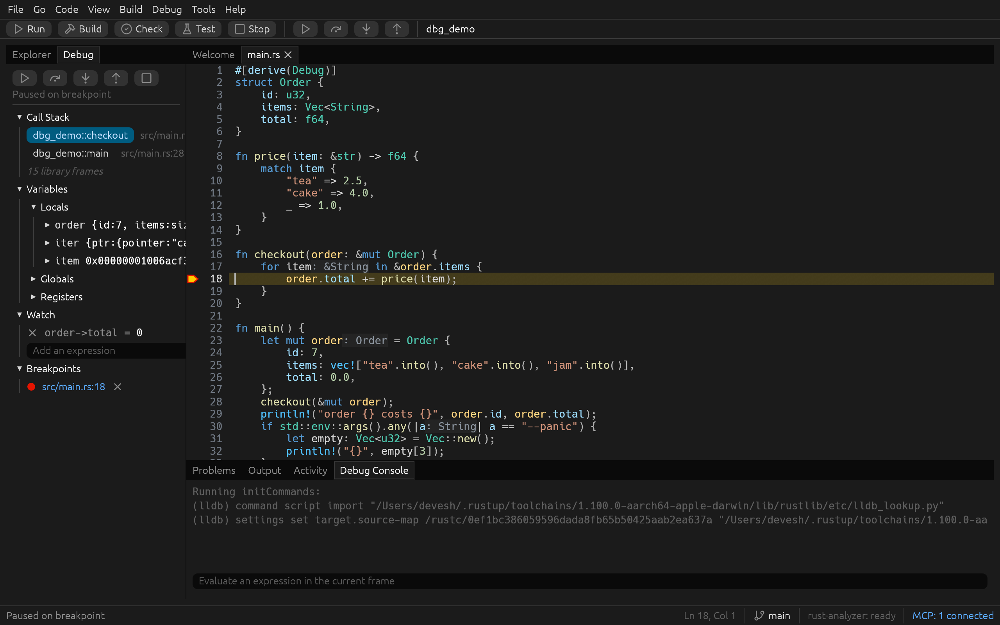

**Lints and formatting.** Clippy runs as you save, so its lints show up in Problems with
quick fixes (Code menu: switch to plain `cargo check` if you prefer speed). Code → Apply
Clippy Fixes and Format Project run `cargo clippy --fix` and `cargo fmt` on everything.

**Source Control.** Stage and unstage files, discard changes (after asking), commit,
switch or create branches, read the history, and fetch, pull and push without leaving
the IDE. Click a changed file or a commit to see its diff.

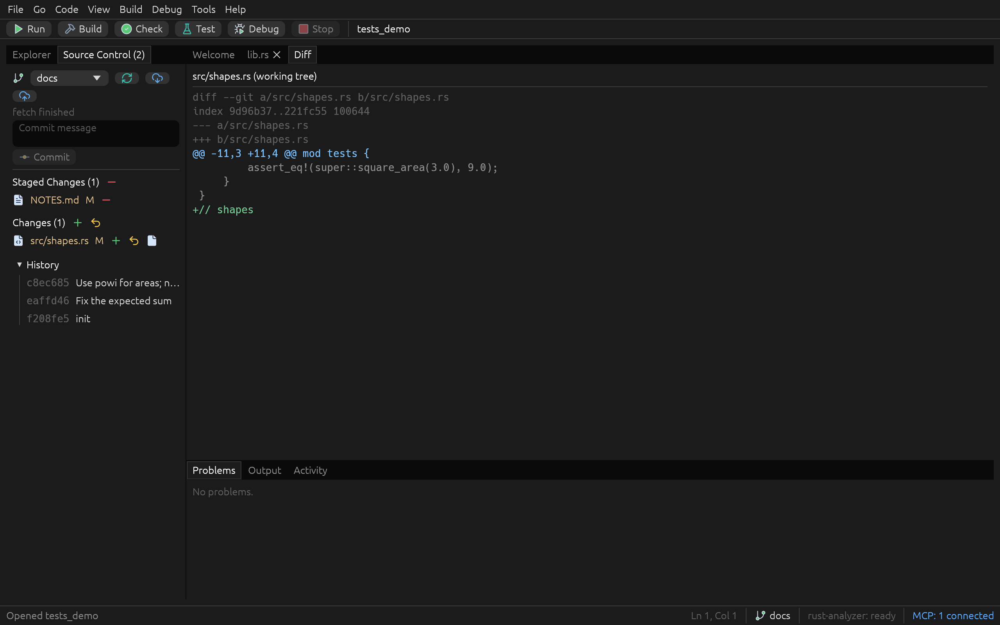

**Test Explorer.** Every test in the project (unit, integration and doc tests) by crate
and module, with its last result. Run all, the failed ones, a module or one test; a
failure shows its output and a link to where it panicked. View → Test Explorer.

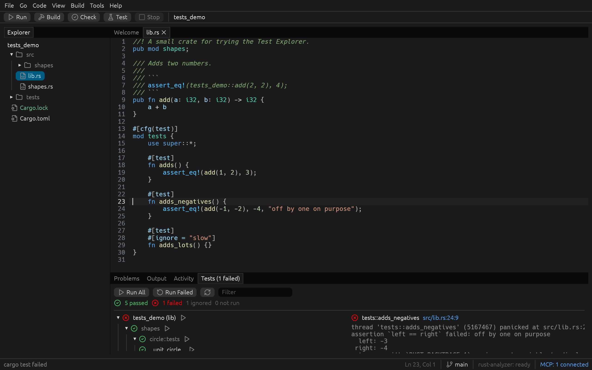

Claude Code can drive all of it, the designer included, over MCP ([docs/mcp.md](docs/mcp.md)).

## Sample app: Stock Viewer

[examples/stock-viewer](examples/stock-viewer) looks up a stock: type a ticker and get the
quote, a closing-price chart (1 month to 5 years), the daily history in a table, company
details from SEC filings, and links to Yahoo Finance, the SEC filings, the latest annual
report and the company website, opened in your browser. Data comes from Yahoo Finance and
SEC EDGAR, with no API keys.

It was built inside PeroxIDE by Claude Code, driving the IDE over MCP. The window was made
in the form designer (layouts, a table, a chart, events wired with Go to handler,
properties used from code), and the Rust was written, built, tested, formatted and
linted through the IDE. [BUILDING.md](examples/stock-viewer/BUILDING.md) records every
step, with screenshots, including the gaps in the tools it found and how they were fixed.

```sh
cargo run -p stock-viewer -- MSFT
```

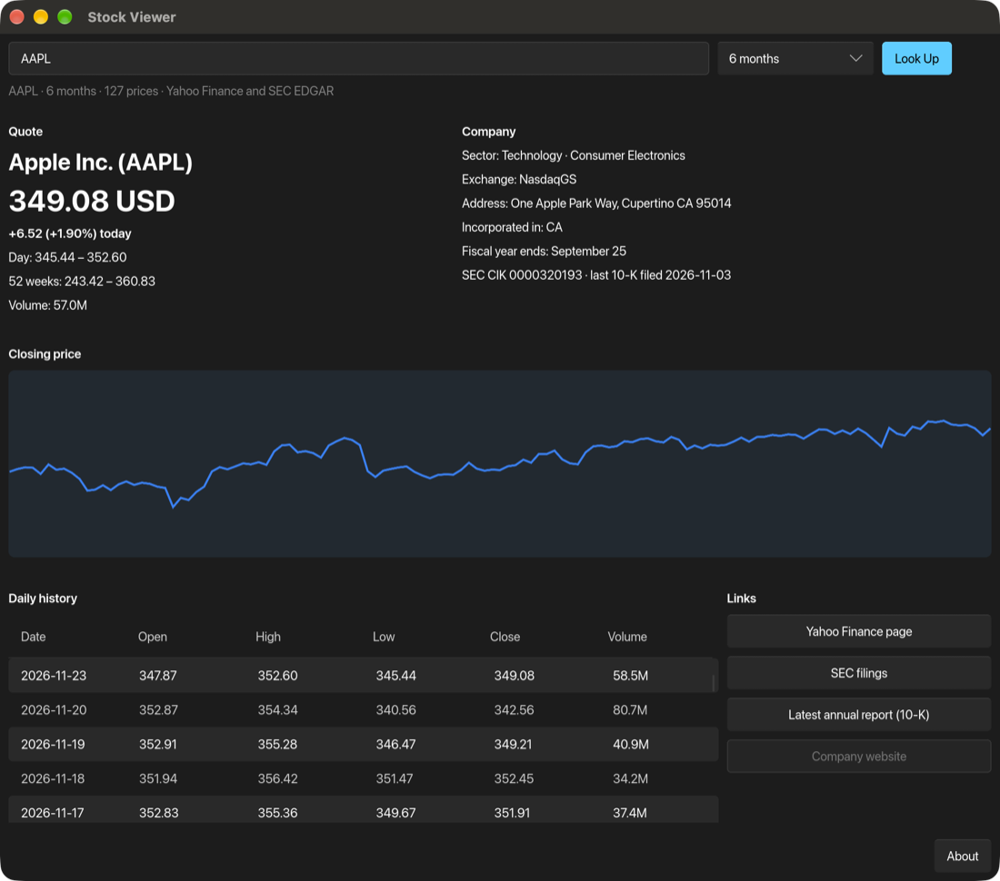

## Sample app: Stock Dashboard

[examples/stock-dashboard](examples/stock-dashboard) is the same idea redesigned the way
Slint apps usually look: a dark window with a sidebar watchlist of live prices, a
gradient-filled chart, stat tiles and rounded cards. It's built from four components made
in the designer (Card, StatTile, a segmented range picker, a watchlist row) and dropped
onto the window from the palette, again by Claude Code over MCP using only the IDE's
tools. Building it found seven gaps in the designer (components taking content, `for` and
`if`, declaring properties and callbacks, handlers with code, and more), each fixed in
PeroxIDE first. [BUILDING.md](examples/stock-dashboard/BUILDING.md) has the record.

```sh
cargo run -p stock-dashboard
```

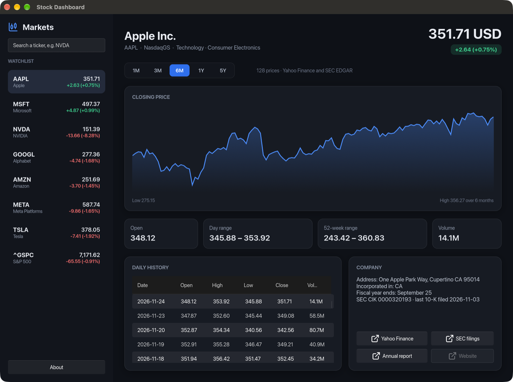

## Build and run

```sh
cargo run -p peroxide        # the IDE
cargo run -p peroxide -- ~/code/my-crate   # …and open a project
cargo test --workspace       # tests
```

The toolchain is pinned in `rust-toolchain.toml`. Each platform also needs:

| OS | Install |
|---|---|
| macOS | Xcode Command Line Tools: `xcode-select --install` |
| Linux (Debian/Ubuntu) | `sudo apt install build-essential libxkbcommon-dev libxcb-render0-dev libxcb-shape0-dev libxcb-xfixes0-dev libwayland-dev libfontconfig-dev` |
| Windows | Visual Studio Build Tools with "Desktop development with C++" |

## Find your way around

| Read | For |
|---|---|
| [ARCHITECTURE.md](ARCHITECTURE.md) | How the pieces fit together; one page. |
| [docs/adr/](docs/adr/) | Why things are the way they are: one page per decision. |
| [docs/roadmap.md](docs/roadmap.md) | What's being built, in which order, and what "done" means for each phase. |
| [docs/mcp.md](docs/mcp.md) | Connecting Claude Code (or any MCP client) to PeroxIDE. |
| [CONTRIBUTING.md](CONTRIBUTING.md) | How to work on the code, plus the CLA. |

## Repository layout

```
apps/peroxide/      the IDE executable (GPL-3.0-or-later)
crates/perox-core/  the command bus (GPL-3.0-or-later)
crates/perox-mcp/   the MCP server (GPL-3.0-or-later)
crates/perox-editor/  the code editor (GPL-3.0-or-later)
crates/perox-lsp/   the rust-analyzer client (GPL-3.0-or-later)
crates/perox-project/ Cargo projects and the file tree (GPL-3.0-or-later)
crates/perox-build/ running cargo (GPL-3.0-or-later)
crates/perox-designer/ the form designer (GPL-3.0-or-later)
crates/perox-slint/ .slint editing and the handlers codegen for build.rs (MIT OR Apache-2.0)
crates/perox-ui/    the runtime in your app: handlers, message boxes, dialogs (MIT OR Apache-2.0)
crates/perox-icons/, perox-terminal/  icons and the terminal
examples/           apps built with PeroxIDE
docs/               ADRs, roadmap, spikes
toolchain-set/      the pinned toolchain + bundled crates, and the check that proves them
```

## License

- **The IDE** (everything not listed below): [GPL-3.0-or-later](LICENSE).
- **Our code inside *your* apps** (`perox-ui`, `perox-slint`, generated code) is
  **MIT OR Apache-2.0** ([LICENSE-MIT](LICENSE-MIT), [LICENSE-APACHE](LICENSE-APACHE)).
- **Your apps also use [Slint](https://slint.dev)**, so they follow one of Slint's
  licenses: GPL-3.0, the free royalty-free license (keep the `AboutSlint` credit the
  template puts in the About dialog), or a paid Slint license. See
  [ADR 0011](docs/adr/0011-slint-for-user-apps.md).

The reasoning is in [ADR 0004](docs/adr/0004-licensing.md). Contributions need the
[CLA](CLA.md).
