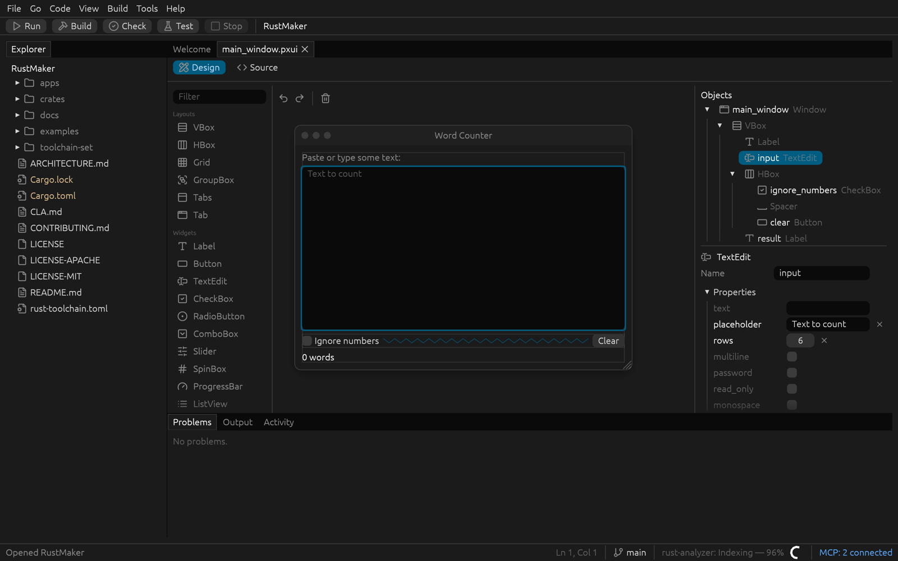
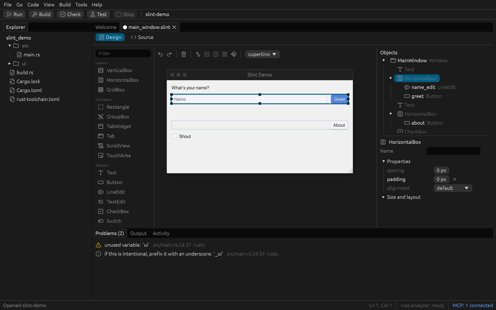
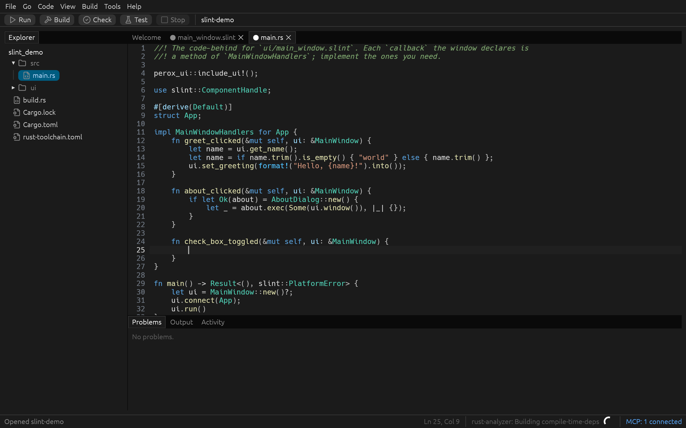
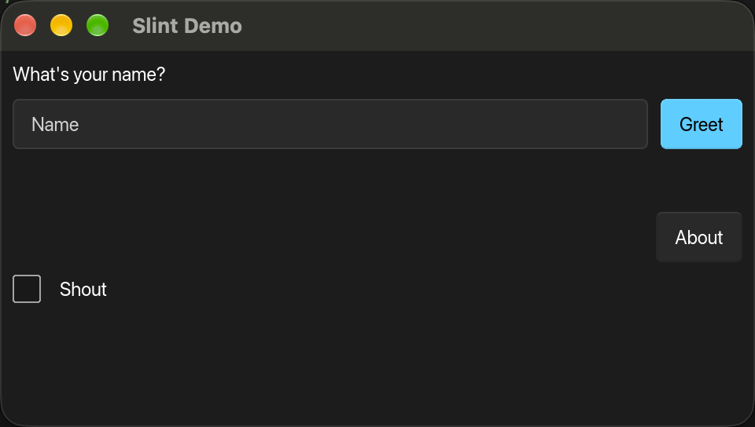

# PeroxIDE

**A complete RAD IDE for building GUI apps in Rust.** A drag-and-drop form
designer with real layouts, a full code editor, a debugger and project
management, all in one install with a pinned, tested Rust toolchain.
It also has a built-in MCP server, so AI agents can drive the IDE.

Targets: **milestone 1 is desktop: macOS, Linux and Windows.** Android comes later.
At that point the IDE itself will run on Android tablets and build installable APKs on
the device.

> Status: **Phases 1 and 2 are done; forms now use [Slint](https://slint.dev)** ([ADR 0011](docs/adr/0011-slint-for-user-apps.md)).
> It's a real Rust IDE with rust-analyzer, plus a form designer for `.slint` files.
> **File → New GUI App** gives you a native-looking window to design, a button wired to
> Rust code, an About dialog, and Run. Phase 3 (pro tooling) is under way: the Test Explorer and the debugger are in. See
> [docs/roadmap.md](docs/roadmap.md).

## Screenshots

**The form designer.** Your app's UI is plain `.slint`, drawn on the canvas by Slint
itself in the style your app will use (Cupertino on macOS, Fluent on Windows and Linux;
switch styles in the toolbar). Drag widgets from the palette; layouts work like Qt's. Edit
properties and events in the inspector. Every change is a small edit to the `.slint` text,
so Undo, the Source view and git diffs all agree, and hand-written Slint opens fine.



**Free placement, like VB or Qt without a layout.** In Slint, anything that isn't a layout
(a window, a `Rectangle`, a tab) places its children by `x`/`y`. Drop widgets anywhere on
the snap grid, move them, resize them with handles, nudge them with the arrow keys.
**Break layout** turns a layout into free placement without moving anything; **Lay out
vertically / horizontally / in a grid** goes back, ordering widgets by where they sit.



**Go to handler.** The arrow next to an event declares a callback on the window, wires the
widget to it, and adds a typed method to your `impl MainWindowHandlers` block, ready to
fill in. rust-analyzer completes the generated `get_*`/`set_*` accessors like any Rust code.



**Dialogs and message boxes.** File → New Dialog… adds a `.slint` dialog with OK and
Cancel; in Rust, `SettingsDialog::new()?.exec(Some(ui.window()), |result| …)` shows it.
For a quick question, `perox_ui::msgbox::confirm(ui, "Delete", "Delete this file?")`
shows the OS's own alert.

**What runs.** Real native windows. Left: [examples/word-counter](examples/word-counter).
Right: a new GUI app with a widget added in the designer.

<p>
  
  
</p>

**Debugger.** Click left of a line number for a breakpoint, press F5. The program builds
and runs under lldb-dap; when it stops you get the line, the call stack (standard library
frames folded away), variables readable through Rust's own formatters, watches, and a
console for expressions. A panic stops where it happened. F10, F11 and Shift+F11 step;
any test can be debugged from the Test Explorer. macOS uses Xcode's lldb-dap; on Linux
install `lldb`, on Windows LLVM ([ADR 0012](docs/adr/0012-debugger.md)).


**Test Explorer.** Every test in the project (unit, integration and doc tests) by crate
and module, with its last result. Run all, the failed ones, a module or one test; a
failure shows its output and a link to where it panicked. View → Test Explorer.


Claude Code can drive all of it, the designer included, over MCP ([docs/mcp.md](docs/mcp.md)).

## Build and run

```sh
cargo run -p peroxide        # the IDE
cargo run -p peroxide -- ~/code/my-crate   # …and open a project
cargo test --workspace       # tests
```

The toolchain is pinned in `rust-toolchain.toml`. Each platform also needs:

| OS | Install |
|---|---|
| macOS | Xcode Command Line Tools: `xcode-select --install` |
| Linux (Debian/Ubuntu) | `sudo apt install build-essential libxkbcommon-dev libxcb-render0-dev libxcb-shape0-dev libxcb-xfixes0-dev libwayland-dev libfontconfig-dev` |
| Windows | Visual Studio Build Tools with "Desktop development with C++" |

## Find your way around

| Read | For |
|---|---|
| [ARCHITECTURE.md](ARCHITECTURE.md) | How the pieces fit together; one page. |
| [docs/adr/](docs/adr/) | Why things are the way they are: one page per decision. |
| [docs/roadmap.md](docs/roadmap.md) | What's being built, in which order, and what "done" means for each phase. |
| [docs/mcp.md](docs/mcp.md) | Connecting Claude Code (or any MCP client) to PeroxIDE. |
| [CONTRIBUTING.md](CONTRIBUTING.md) | How to work on the code, plus the CLA. |

## Repository layout

```
apps/peroxide/      the IDE executable (GPL-3.0-or-later)
crates/perox-core/  the command bus (GPL-3.0-or-later)
crates/perox-mcp/   the MCP server (GPL-3.0-or-later)
crates/perox-editor/  the code editor (GPL-3.0-or-later)
crates/perox-lsp/   the rust-analyzer client (GPL-3.0-or-later)
crates/perox-project/ Cargo projects and the file tree (GPL-3.0-or-later)
crates/perox-build/ running cargo (GPL-3.0-or-later)
crates/perox-designer/ the form designer (GPL-3.0-or-later)
crates/perox-slint/ .slint editing and the handlers codegen for build.rs (MIT OR Apache-2.0)
crates/perox-ui/    the runtime in your app: handlers, message boxes, dialogs (MIT OR Apache-2.0)
crates/perox-icons/, perox-terminal/  icons and the terminal
examples/           apps built with PeroxIDE
docs/               ADRs, roadmap, spikes
toolchain-set/      the pinned toolchain + bundled crates, and the check that proves them
```

## License

- **The IDE** (everything not listed below): [GPL-3.0-or-later](LICENSE).
- **Our code inside *your* apps** (`perox-ui`, `perox-slint`, generated code) is
  **MIT OR Apache-2.0** ([LICENSE-MIT](LICENSE-MIT), [LICENSE-APACHE](LICENSE-APACHE)).
- **Your apps also use [Slint](https://slint.dev)**, so they follow one of Slint's
  licenses: GPL-3.0, the free royalty-free license (keep the `AboutSlint` credit the
  template puts in the About dialog), or a paid Slint license. See
  [ADR 0011](docs/adr/0011-slint-for-user-apps.md).

The reasoning is in [ADR 0004](docs/adr/0004-licensing.md). Contributions need the
[CLA](CLA.md).
