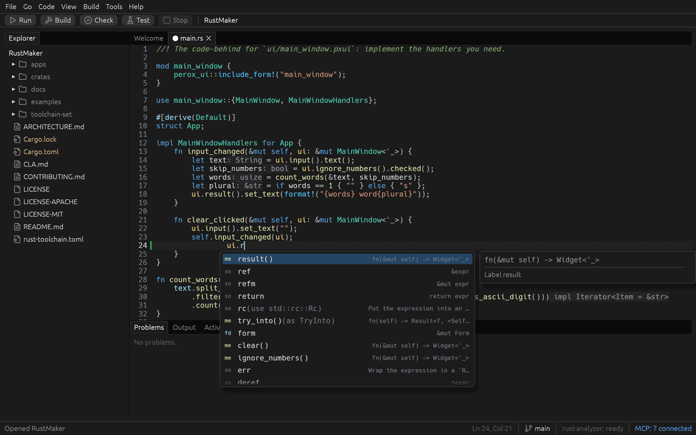
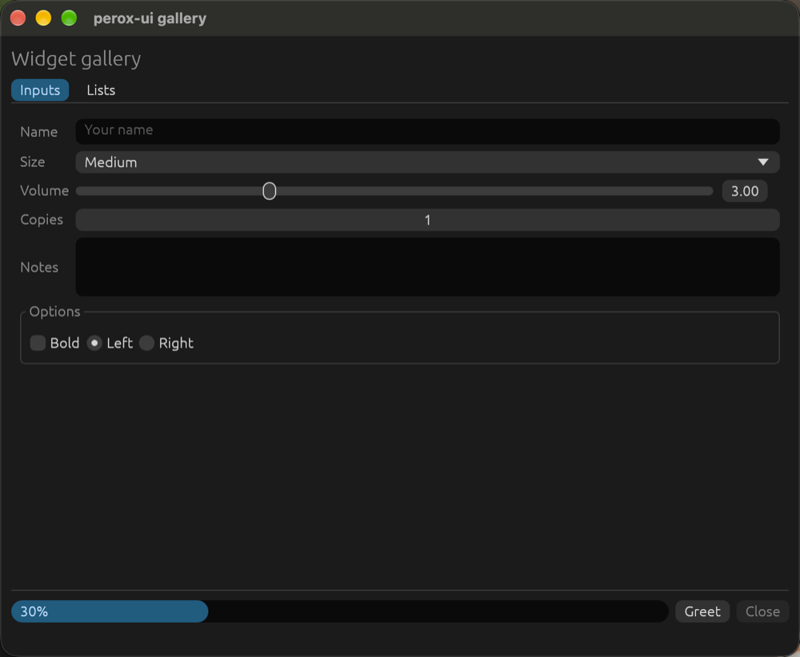

# PeroxIDE

**A complete RAD IDE for building GUI apps in Rust.** A drag-and-drop form
designer with real layouts, a full code editor, a debugger and project
management, all in one install with a pinned, tested Rust toolchain.
It also has a built-in MCP server, so AI agents can drive the IDE.

Targets: **milestone 1 is desktop: macOS, Linux and Windows.** Android comes later.
At that point the IDE itself will run on Android tablets and build installable APKs on
the device.

> Status: **Phase 1 (a real Rust IDE) is done. Phase 2 (forms) is nearly done:** the form
> designer, the `perox-ui` runtime and code generation work end to end. A "New GUI app"
> template is next. See [docs/roadmap.md](docs/roadmap.md).

## Screenshots

**The form designer.** Drag widgets from the palette onto the form. Layouts work like
Qt's. Edit properties and events in the inspector. Every change is a small edit to the
`.pxui` text, so Undo, the Source view and git diffs all agree.


**The code-behind, with rust-analyzer.** The designer generates typed accessors
(`ui.result()`) and a handlers trait. Completion, inlay hints and hover work on them like
any Rust code. "Go to handler" in the inspector adds the method for you.



**What runs.** The same runtime draws the designer canvas and your app, so what you
design is what ships. Left: [examples/word-counter](examples/word-counter). Right:
`cargo run -p perox-ui --example gallery`.

<p>
  
  
</p>

Claude Code can drive all of it, the designer included, over MCP ([docs/mcp.md](docs/mcp.md)).

## Build and run

```sh
cargo run -p peroxide        # the IDE
cargo run -p peroxide -- ~/code/my-crate   # …and open a project
cargo test --workspace       # tests
```

The toolchain is pinned in `rust-toolchain.toml`. Each platform also needs:

| OS | Install |
|---|---|
| macOS | Xcode Command Line Tools: `xcode-select --install` |
| Linux (Debian/Ubuntu) | `sudo apt install build-essential libxkbcommon-dev libxcb-render0-dev libxcb-shape0-dev libxcb-xfixes0-dev libwayland-dev` |
| Windows | Visual Studio Build Tools with "Desktop development with C++" |

## Find your way around

| Read | For |
|---|---|
| [ARCHITECTURE.md](ARCHITECTURE.md) | How the pieces fit together; one page. |
| [docs/adr/](docs/adr/) | Why things are the way they are: one page per decision. |
| [docs/roadmap.md](docs/roadmap.md) | What's being built, in which order, and what "done" means for each phase. |
| [docs/mcp.md](docs/mcp.md) | Connecting Claude Code (or any MCP client) to PeroxIDE. |
| [CONTRIBUTING.md](CONTRIBUTING.md) | How to work on the code, plus the CLA. |

## Repository layout

```
apps/peroxide/      the IDE executable (GPL-3.0-or-later)
crates/perox-core/  the command bus (GPL-3.0-or-later)
crates/perox-mcp/   the MCP server (GPL-3.0-or-later)
crates/perox-editor/  the code editor (GPL-3.0-or-later)
crates/perox-lsp/   the rust-analyzer client (GPL-3.0-or-later)
crates/perox-project/ Cargo projects and the file tree (GPL-3.0-or-later)
crates/perox-build/ running cargo (GPL-3.0-or-later)
crates/perox-designer/ the form designer (GPL-3.0-or-later)
crates/perox-forms/ the .pxui language and code generation (MIT OR Apache-2.0)
crates/perox-ui/    the form runtime that ships in your app (MIT OR Apache-2.0)
crates/perox-icons/, perox-terminal/  icons and the terminal
examples/           apps built with PeroxIDE
docs/               ADRs, roadmap, spikes
toolchain-set/      the pinned toolchain + bundled crates, and the check that proves them
```

## License

- **The IDE** (everything not listed below): [GPL-3.0-or-later](LICENSE).
- **Everything that ends up inside *your* apps**: the `perox-ui` runtime, the `.pxui`
  format and the component SDK are **MIT OR Apache-2.0**
  ([LICENSE-MIT](LICENSE-MIT), [LICENSE-APACHE](LICENSE-APACHE)). Apps you build
  with PeroxIDE are yours, under any license you like.

The reasoning is in [ADR 0004](docs/adr/0004-licensing.md). Contributions need the
[CLA](CLA.md).
