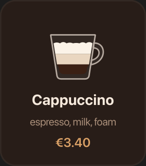
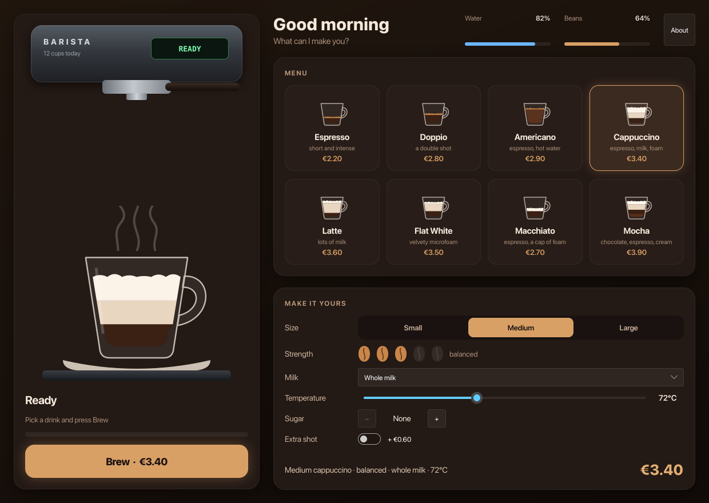
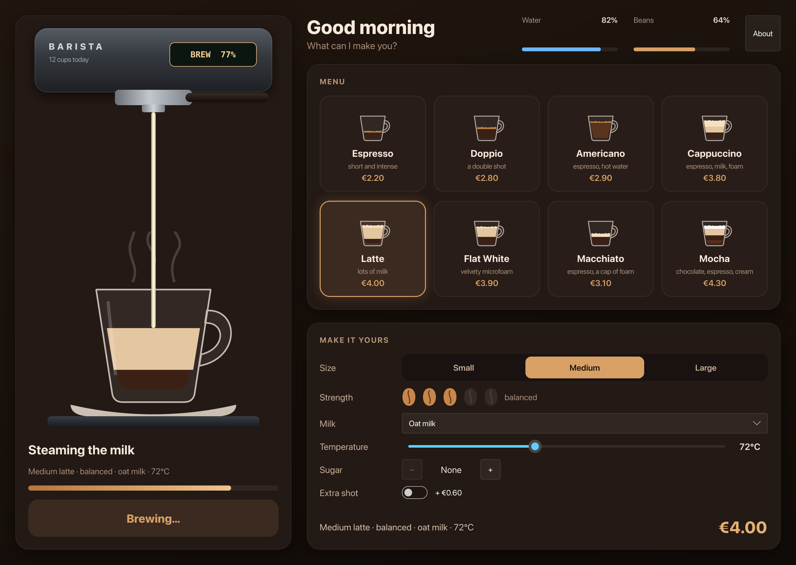

# Building Barista with PeroxIDE

How this sample was made: by an AI agent (Claude Code) driving PeroxIDE over its MCP
server, using only the IDE's own commands: 283 calls, from `project.new` to `build.fmt`.
The brief was "a sample app for a coffee machine, with nice computed vector graphics,
several drink types and configurations". Four gaps in the tools turned up; each is below
with its fix, made in PeroxIDE before carrying on.

## 1. The parts

**Card** and **Segmented** as in the other samples, in coffee colours. A picked pill
should glide to caramel, not jump.

> **Gap 1: no animations.** Slint animates a property with `animate background { … }`;
> the designer could neither show nor write one. **Fix:** an *Animations* section in the
> inspector (each animated property with its duration and easing; *Animate…* for the
> colours, lengths and numbers not yet animated), and `designer.set_animation` over MCP.
```
designer.set_animation { widget: "pill", property: "background", duration: "180ms", easing: "ease-out" }
```
Used afterwards on the drink tiles (background, border, glow), the strength beans, the
progress bar, the gauges, the Brew button, the screen's border and the stream.

**DrinkTile**: a drink's cup, drawn from its layers, then name, note and price. Its data
types were typed in the Source view:
```
editor.replace { path: "ui/parts/drink_tile.slint", …,
  text: "export struct Layer { commands: string, color: color }\nexport struct DrinkData { name: string, note: string, price: string, layers: [Layer] }" }
designer.declare_property { name: "drink", type: "DrinkData", default: "{ name: \"Cappuccino\", …, layers: [{ commands: \"M 78 164 Q 62 164 …\", color: #3b2014 }, …] }" }
designer.add_widget       { parent: "mini", kind: "Path", id: "liquid",
                            props: { commands: "layer.commands", fill: "layer.color", viewbox-width: "200", viewbox-height: "200", … } }
designer.set_header       { widget: "liquid", header: "for layer in root.drink.layers" }
```
The default is a real cappuccino: the cup geometry (`src/cup.rs`) was written first and
its output pasted in, so the designer shows real cups.



**Gauge**: a label, a percentage (`"\{round(root.value * 100)}%"`) and a bar whose width
animates.

## 2. The window

The window shares about thirty properties with the code: the menu (`[[DrinkData]]`), the
cup's layers (`[Layer]`), the steam, the stream, the options, the status texts.

> **Gap 2: a struct from another file wasn't imported.** Declaring `menu` as
> `[[DrinkData]]` left the window without `import { DrinkData } …`, so it didn't compile.
> **Fix:** declaring a property (in the inspector or over MCP) imports any struct its
> type names that another `.slint` file of the project exports, as dropping a component
> imports the component.

The machine is built from Rectangles with metal gradients; the cup from Paths in a
200 × 200 view box, their commands from Rust; a `Timer` ticks while something moves:
```
designer.add_widget { parent: "#", kind: "Timer", id: "ticker", props: { interval: "33ms", running: "root.animating" } }
designer.set_handler { widget: "ticker", event: "triggered", code: "root.tick();" }
```

The first screenshot showed the stream cut off at the top of the cup's area: a `Path`
is clipped to its box. The stream became a `Rectangle` of the machine, from the spouts
down to the liquid (`height: cup_area.y + root.stream_end * 1.5px - self.y`), and the cup
moved behind the machine head in the drawing order (`designer.move_widget`).

The options are a `GridLayout`; the milk, temperature and extra-shot controls are tied to
the window's properties both ways:
```
designer.add_widget { parent: "option_grid", kind: "ComboBox", id: "milk_pick",
                      props: { row: "2", col: "1", model: "root.milks", current-index: "<=> root.milk" } }
```

> **Gap 3: two-way bindings given when adding an element came out wrong.** `<=> root.milk`
> worked in `set_property` (from the Graphing Calculator) but `add_widget` wrote
> `current-index: <=> root.milk;`, which doesn't parse. **Fix:** new elements write it as
> `current-index <=> root.milk;` too. (The three lines were corrected in the Source view.)

> **Gap 4: new plain layouts got names.** Each `VerticalLayout`/`HorizontalLayout` added
> came out as `vertical_layout1 := …`, names nothing uses. **Fix:** like the Box layouts,
> they stay unnamed.

A second look: the options ran off the bottom, the labels took half the width, and the
tiles were uneven. Fixed with smaller tiles, `horizontal-stretch` on the controls, and a
taller window.



## 3. The code

```
file.write { path: "src/cup.rs",    … }   // the glass, layers, steam; colours; tests
file.write { path: "src/drinks.rs", … }   // recipes, options, price, summary; tests
file.write { path: "src/main.rs",   … }   // MainWindowHandlers and the brewing
build.test {}
```
Start-up options (`--drink`, `--milk`, `--size`, `--strength`, `--brew-at`) let a
screenshot show the machine mid-brew.

## 4. What Run and Screenshot caught

```
build.snapshot { out: "docs/app-brewing.png", args: ["--drink", "Latte", "--milk", "oat", "--brew-at", "4.2"] }
```
The running app drew the glass and the saucer as filled boxes and showed no steam, while
the designer showed them right. Running the same build under each of Slint's renderers
(`SLINT_BACKEND=winit-software`, `winit-skia`, `winit-femtovg`) showed the software
renderer, the one the designer uses, draws them correctly, and both GPU renderers
don't, even with opaque fills and no opacity. The app now asks for the software renderer
(`slint::BackendSelector`), which is plenty for a panel like this; `SLINT_BACKEND`
still overrides it.



The finished state, for the README: `--drink Mocha --size large --strength 4 --brew-at 9`.

Picking drinks, the options and the Brew button weren't driven by automation; they go
through the same functions as the start-up options.

## 5. Finish

```
build.clippy {}    // no warnings
build.fmt {}
```
Moved into the repository as `examples/barista`, where it builds, tests and passes
clippy with the workspace's lints.

## Tools added for this

| Gap | Now |
|---|---|
| No animations | *Animations* in the inspector; `designer.set_animation` |
| A struct from another file wasn't imported | Declaring a property imports the structs its type names |
| `<=>` given to `add_widget` wrote broken code | Written as a two-way binding |
| New plain layouts got names | They stay unnamed |
