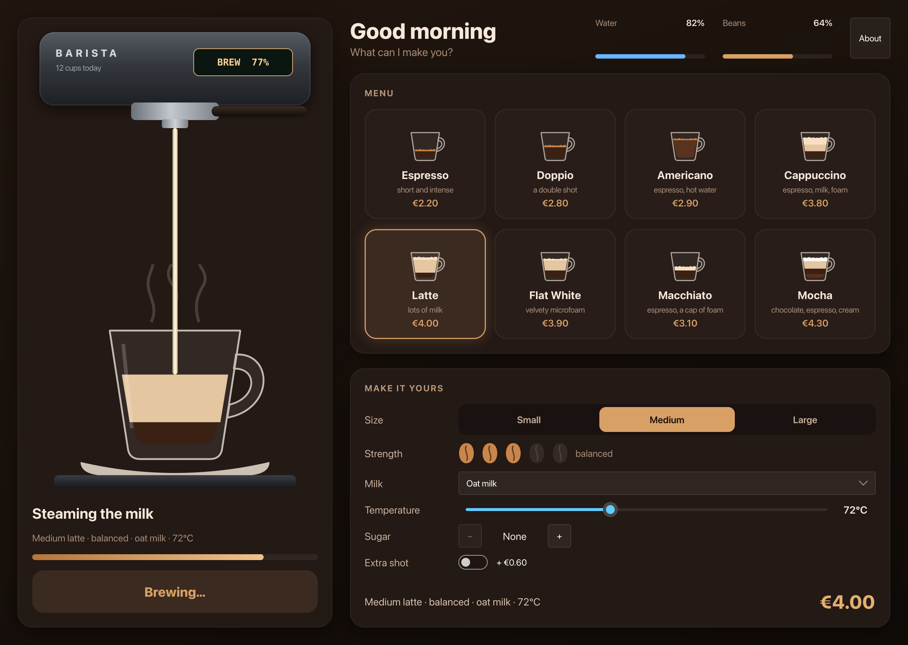
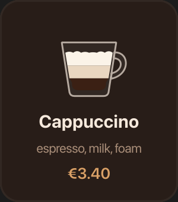
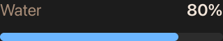
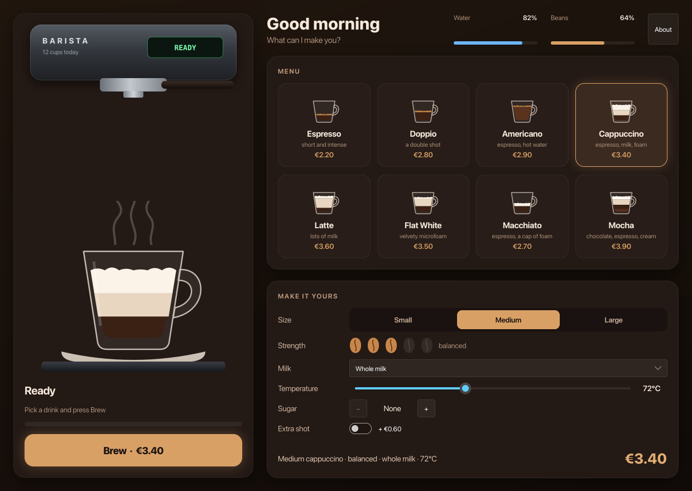
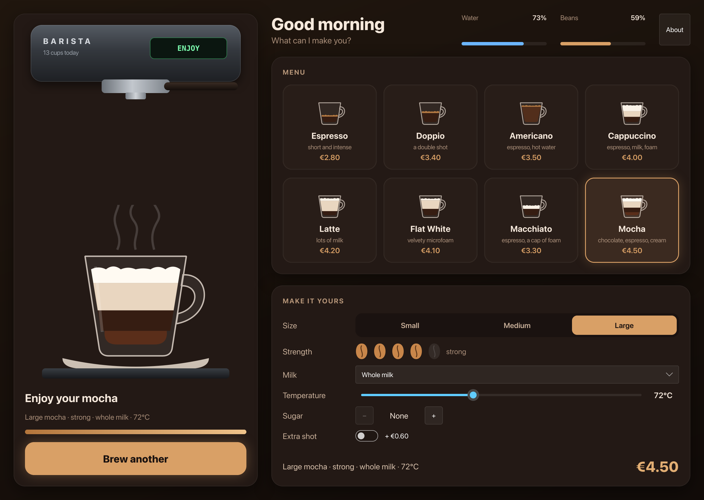

# Barista

A PeroxIDE sample: the touch panel of an espresso machine. Pick a drink, make it yours,
press Brew, and watch the cup fill: the beans grind, the shot pulls, the milk pours, the
foam goes on top, and the finished cup steams until it cools.



- **Eight drinks**: espresso, doppio, americano, cappuccino, latte, flat white,
  macchiato, mocha. Each tile shows its cup, layer by layer.
- **Make it yours**: size, strength (the beans), milk (whole, oat, almond, skimmed, none),
  temperature, sugar, an extra shot. The menu's cups, the summary and the price follow:
  no milk turns a cappuccino black, stronger coffee is darker, oat milk is creamier in
  colour and costs a little more.
- **Brewing**: the machine's screen counts up, each step is named, the stream takes the
  colour of what's pouring, and the water and bean gauges go down.

All the drawing is vector paths computed in Rust: the glass, every layer at every moment
of pouring (foam and crema with soft waves on top), and the steam, which sways and fades
as the cup cools.

It was built inside PeroxIDE by an AI agent (Claude Code) driving the IDE over MCP: the
parts and the window in the form designer, the code written, tested, run, linted and
formatted through the IDE. [BUILDING.md](BUILDING.md) is the record, with the four gaps
it found in PeroxIDE and how they were fixed.

## Run it

```sh
cargo run -p barista                                        # from the PeroxIDE repository
cargo run -p barista -- --drink Mocha --size large --brew-at 0   # start brewing a large mocha
```

Or open this folder in PeroxIDE and press Run. Tests: `cargo test -p barista`.

## How it's put together

| Part | What it is | |
|---|---|---|
| `ui/parts/drink_tile.slint` | A drink: its cup (a `Path` per layer over a glass), name, note and price; highlighted when picked. Exports the `Layer` and `DrinkData` structs. |  |
| `ui/parts/gauge.slint` | A reading as a bar; red when low. |  |
| `ui/parts/segmented.slint`, `card.slint` | The size picker and the panels. | |

| File | What's in it |
|---|---|
| `ui/main_window.slint` | The machine (head, screen, group head, portafilter, the cup on its saucer, the stream, the steam, the drip tray), the menu (a `DrinkTile` per drink, rows of `menu`), the options and the total. A `Timer` ticks while something moves. Hover and selection colours, the progress bar, the gauges and the stream fade in and out with animations. |
| `src/cup.rs` | The geometry: the glass and saucer, a layer between two fill levels following the tapered walls and rounded bottom, the steam; liquid colours by strength and milk. |
| `src/drinks.rs` | The menu's recipes; what options do to them; price and the summary line. |
| `src/main.rs` | `MainWindowHandlers`, and the brewing: grind, then pour each layer in turn. |

| Designed in PeroxIDE | Done: a large mocha |
|---|---|
|  |  |

The app uses Slint's software renderer: Slint 1.19's GPU renderers drew the glass and the
saucer as boxes and left out the steam (see BUILDING.md). `SLINT_BACKEND` overrides it.

Licence: MIT OR Apache-2.0; a build you distribute uses Slint under one of its licences
(the About dialog carries the credit its free licence asks for).
