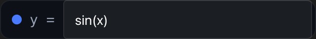
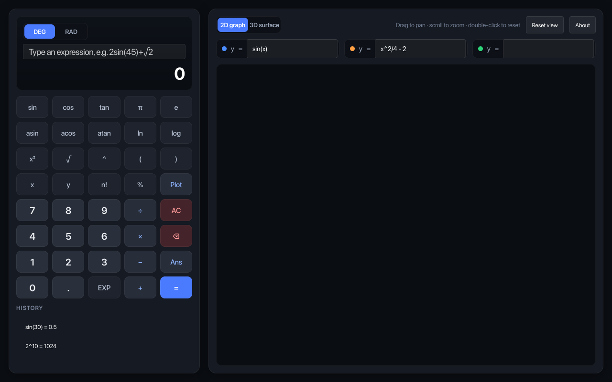
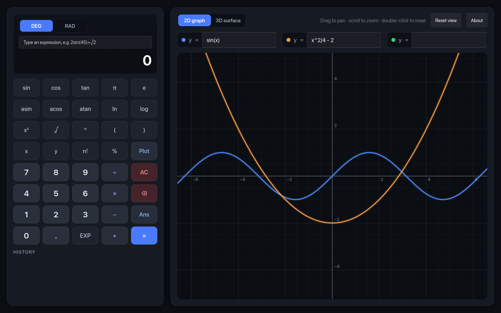
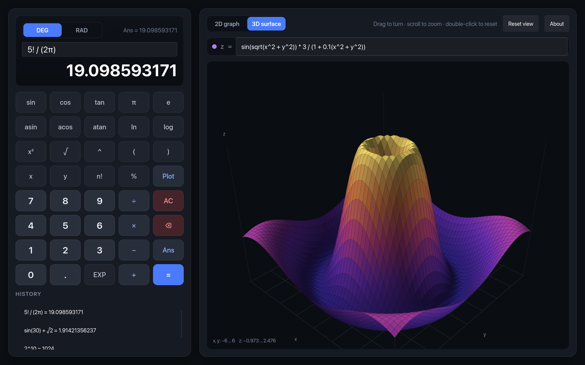

# Building Graphing Calculator with PeroxIDE

How this sample was made: by an AI agent (Claude Code) driving PeroxIDE over its MCP
server, using only the IDE's own commands: 216 calls, from `project.new` to `build.fmt`.
The brief was "a really nice scientific and graphing calculator, with 3D graphs too",
made with the RAD tools, adding tools where they fell short. Six did; each is below with
its fix, made in PeroxIDE's own code before carrying on.

The calls are shown shortened (paths relative to the project folder).

## 1. Project and look

```
project.new         { path: "P", template: "gui" }
designer.app_style  { path: "ui/main_window.slint", style: "fluent", color_scheme: "dark" }
```

## 2. The parts

Each part is a **New Component** (`form.new { kind: "component" }`), its own properties and
events declared, its elements dropped in.

**Key**, the keypad's button. One property, `role`, picks the colours, with hover and
press shades written as expressions on the root:
```
designer.declare_property { name: "label", type: "string", default: "\"7\"" }
designer.declare_property { name: "role",  type: "string", default: "\"digit\"" }
designer.declare_callback { name: "clicked" }
designer.set_property     { widget: "#", name: "background",
                            value: "root.role == \"accent\" ? (area.pressed ? #3563d6 : area.has-hover ? #5b8cff : #4a7bff) : …" }
designer.add_widget       { parent: "#", kind: "TouchArea", id: "area" }
designer.set_handler      { widget: "area", event: "clicked", code: "root.clicked();" }
```

**Card** and **Segmented**, as in the Stock Dashboard sample.

**FnField**: a dot, `y =`, and a `LineEdit` for the expression. The part's `text` has to
*be* the LineEdit's text, both ways.

> **Gap 1: a widget's property could only be passed through as `<id>_<prop>`.** "Use
> Property from Code" named it `field_text`; a part wants to call it `text`. **Fix:**
> `designer.expose` takes `as`: `in-out property <string> text <=> field.text;`.



## 3. The window

Two structs typed in the Source view (data, not something to draw):
```
editor.replace { …, text: "export struct KeyData { label: string, role: string }\nexport struct PlotLabel { x: length, y: length, text: string }" }
```

The keypad is data too: `keys`, a list of rows, declared with the whole layout as its
default, so the designer shows the real keypad and the code never sets it:
```
designer.declare_property { name: "keys", type: "[[KeyData]]",
                            default: "[[{ label: \"sin\", role: \"fn\" }, …, { label: \"=\", role: \"accent\" }]]" }
designer.add_widget       { parent: "keypad", kind: "HorizontalLayout", id: "key_row" }
designer.set_header       { widget: "key_row", header: "for row in root.keys" }
designer.add_widget       { parent: "key_row", kind: "Key", id: "key", props: { label: "k.label", role: "k.role", … } }
designer.set_header       { widget: "key", header: "for k in row" }
designer.set_handler      { widget: "key", event: "clicked", code: "root.key_pressed(k.label);" }
```

The function fields show only in their mode: `if root.mode == 0` around the three `y =`
fields, `if root.mode == 1` on the `z =` one. The window keeps the functions (`fn1`,
`fn2`, `fn3`, `fn_z`) so they survive switching.

> **Gap 2: a project component's property couldn't be used from code at all.**
> "Use Property from Code" knew only the built-in widgets' properties; on `FnField` it said
> "can't expose this property yet". **Fix:** for a project component it takes the type from
> the property's declaration.

> **Gap 3: no two-way bindings.** Even exposed, a property of an element inside `if`
> can't be reached from outside it (Slint's rule). Slint's answer is a binding on the
> element itself, `text <=> root.fn1;`, which the designer couldn't write or read.
> **Fix:** a property value of `<=> root.fn1` is written as a two-way binding, read back as
> one, and shown as source in the inspector.
```
designer.set_property { widget: "f1", name: "text", value: "<=> root.fn1" }
```

Then the plot: something only code can draw.

> **Gap 4: nowhere to draw.** The designer had shapes (`Path`) but nothing for a picture
> the code computes: a graph, a surface, a chart. **Fix:** a **Canvas** in the palette. It
> is an `Image` named, say, `plot`, wired for code to draw into: it declares `plot_image`
> (the picture), `plot_width`/`plot_height` (its size) and `plot_resized()` (draw again).
> On the code side, `perox_ui::canvas::Canvas` gives a tiny-skia pixmap at the window's
> scale and hands it over as an image.

> **Gap 5: no `changed` handlers.** Redrawing on resize needs Slint's
> `changed width => { … }`, which the parser skipped and the editor couldn't write.
> **Fix:** they're handlers named `changed width`, read and written like any event; the
> Canvas uses them.
```
designer.add_widget  { parent: "plot_area", kind: "Canvas", id: "plot", props: { width: "parent.width", height: "parent.height" } }
designer.add_widget  { parent: "plot_area", kind: "Text", id: "axis_label", props: { x: "l.x", y: "l.y", text: "l.text", … } }
designer.set_header  { widget: "axis_label", header: "for l in root.plot_labels" }
designer.add_widget  { parent: "plot_area", kind: "TouchArea", id: "plot_touch" }
designer.set_handler { widget: "plot_touch", event: "moved", code: "root.plot_dragged(self.mouse-x / 1px, self.mouse-y / 1px);" }
designer.set_handler { widget: "plot_touch", event: "scroll-event", params: ["event"],
                       code: "root.plot_scrolled(event.delta-y / 1px); return accept;" }
```
Axis labels are `Text`s over the canvas rather than drawn into it, so they use the app's
font.

`designer.tree` reported no errors after each step.



## 4. The code

```
file.write { path: "src/expr.rs",   … }   // parser and evaluator, with tests
file.write { path: "src/plot2d.rs", … }   // the 2D graph, with tests
file.write { path: "src/plot3d.rs", … }   // the surface, with tests
file.write { path: "src/main.rs",   … }   // MainWindowHandlers
build.test {}
```
Two tests failed the first time, both fair: `sin 30` in degrees came out as
0.49999999999999994 (trigonometry now rounds to 14 decimals), and on a square canvas the
3D box's near corner ran off the edge (milder perspective, a size that fits).

## 5. Look at the running app

> **Gap 6: no way to see the running app.** The designer's screenshot shows the form, not
> what the code draws into it; and this was built at night with the Mac's screen locked, so
> an ordinary screenshot showed the lock screen. **Fix:** **Run and Screenshot**
> (`build.snapshot`). It runs the app with `PEROX_SNAPSHOT=<file>`, and perox-ui's generated
> `connect` saves the window (Slint's `take_snapshot`) once it has settled, then quits.
> It works with the screen locked.

```
build.snapshot { out: "docs/app-2d.png" }
```


To show a calculation and the surface, the app got start-up options (`--calc`, `--3d`):
```
build.snapshot { out: "docs/app-3d.png", args: ["--calc", "2^10", "--calc", "sin(30) + √2",
                 "--calc", "5! / (2π)", "--3d", "sin(sqrt(x^2 + y^2)) * 3 / (1 + 0.1(x^2 + y^2))"] }
```
The first one had the axis letters on the box's far edges, behind the surface; they moved
to the nearer edges.



Dragging and zooming weren't driven by automation; they go through the same view
functions the tests cover.

## 6. Finish

```
build.clippy {}    // three warnings: View is Copy (take self), a type for (expression, colour)
build.fmt {}
```
Moved into the repository as `examples/graphing-calculator`, where it builds, tests and
passes clippy with the workspace's stricter lints.

## Tools added for this

| Gap | Now |
|---|---|
| A widget's property passed through only as `<id>_<prop>` | `designer.expose { as }` |
| A project component's property couldn't be used from code | Typed from its declaration |
| No two-way bindings | `<=> root.x` values: written, read, shown as source |
| Nowhere for code to draw | **Canvas** in the palette; `perox_ui::canvas` |
| No `changed` handlers | `changed <property>` events |
| No way to see the running app | **Run and Screenshot** (`build.snapshot`), works with the screen locked |
