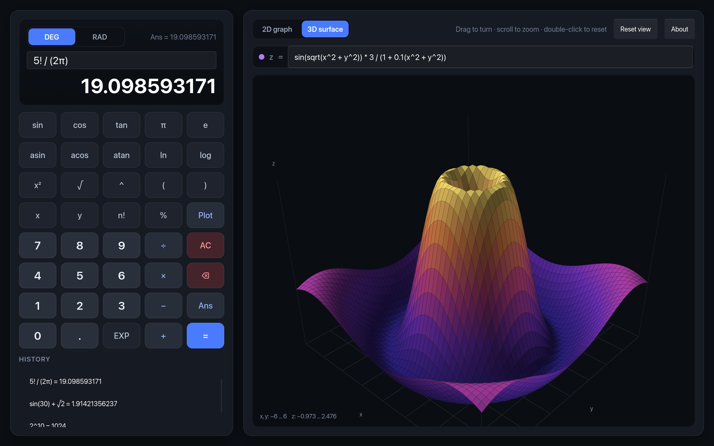
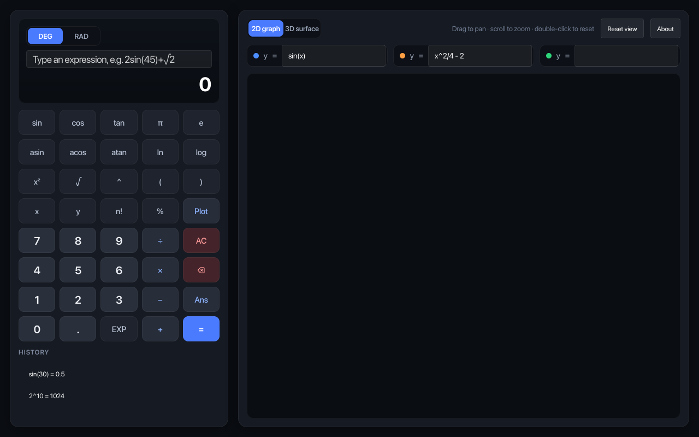
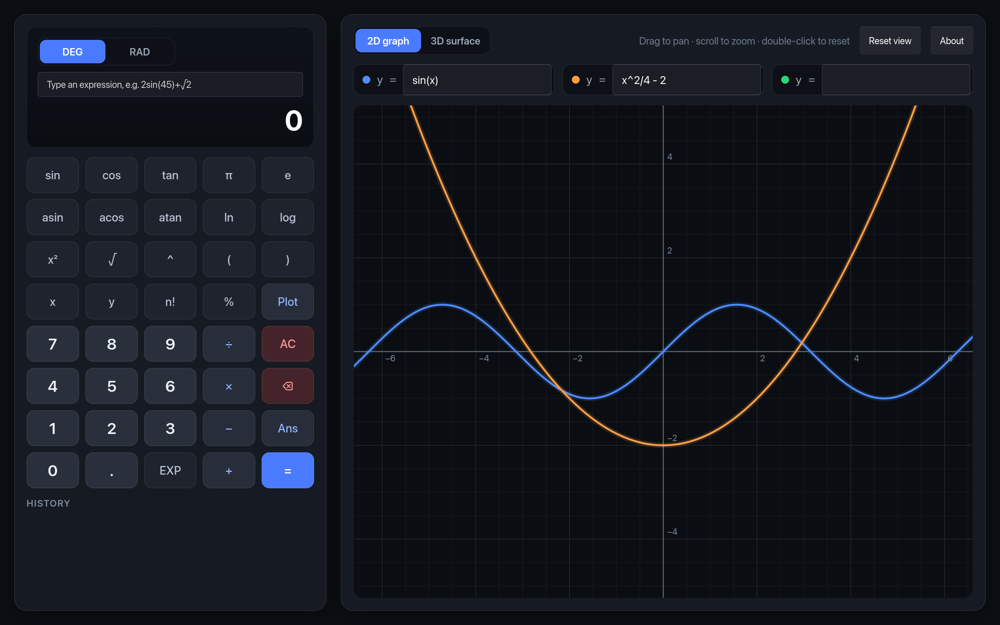

# Graphing Calculator

A PeroxIDE sample: a scientific calculator, a 2D graph of up to three functions, and a 3D
surface you turn with the mouse.



- **Calculator**: the keypad or typing; `sin cos tan` and their inverses, `ln log √ x² ^ n! %`,
  `π e`, `Ans`, brackets, implicit multiplication (`2π`, `3sin(45)`, `(x+1)(x−1)`), degrees
  or radians. Results to 12 digits; earlier ones in History, a click to use one again.
- **2D graph**: `y =` up to three functions of `x`, in blue, orange and green. Drag to pan,
  scroll to zoom, double-click to reset. Gaps where a function isn't defined (no line
  across `tan`'s asymptotes).
- **3D surface**: `z = f(x, y)`, coloured by height and lit, over x and y from −6 to 6.
  Drag to turn and tilt, scroll to zoom.
- **Plot** sends what's in the calculator to the graph: to the surface if it has a `y`.

It was built inside PeroxIDE by an AI agent (Claude Code) driving the IDE over MCP: the
parts and the window in the form designer, the code written, tested, run, linted and
formatted through the IDE. [BUILDING.md](BUILDING.md) is the record, including the six
gaps it found in PeroxIDE and how they were fixed.

## Run it

```sh
cargo run -p graphing-calculator                     # from the PeroxIDE repository
cargo run -p graphing-calculator -- --3d "x*y/5"     # start on a surface
cargo run -p graphing-calculator -- --calc "5!/(2π)" # work something out first
```

Or open this folder in PeroxIDE and press Run. Tests: `cargo test -p graphing-calculator`.

## How it's put together

| Part | What it is | |
|---|---|---|
| `ui/parts/key.slint` | A key: its role (digit, operator, function, `=`, clear) picks its colours; hover and press shades. |  |
| `ui/parts/fn_field.slint` | A coloured dot, `y =`, and the expression; its border turns red when the expression doesn't parse. |  |
| `ui/parts/segmented.slint` | A row of pills, one picked: DEG/RAD and 2D/3D. |  |
| `ui/parts/card.slint` | The rounded panels. | |

| File | What's in it |
|---|---|
| `ui/main_window.slint` | The window. The keypad is a `Key` per item of `keys`, a list of rows written in the file (`for row in root.keys` → `for k in row`), so changing the keypad is an edit to that list. The plot is a **Canvas** (`plot`), the axis labels a `Text` per item of `plot_labels` over it, and a `TouchArea` for the mouse. |
| `src/expr.rs` | Expressions: a tokenizer and a recursive-descent parser into a tree, evaluated as often as a plot needs; result formatting. |
| `src/plot2d.rs` | The 2D graph with tiny-skia: grid (1, 2, 5 × 10ⁿ steps), axes, curves with a glow, labels; panning and zooming about the mouse. |
| `src/plot3d.rs` | The surface: a 48 × 48 grid of quads, perspective, lit by a fixed light, coloured by height, drawn back to front. |
| `src/main.rs` | `MainWindowHandlers`: keys, evaluation, history, the plots and the mouse. |

| Designed in PeroxIDE | The 2D graph |
|---|---|
|  |  |

Licence: MIT OR Apache-2.0; a build you distribute uses Slint under one of its licences
(the About dialog carries the credit its free licence asks for).
