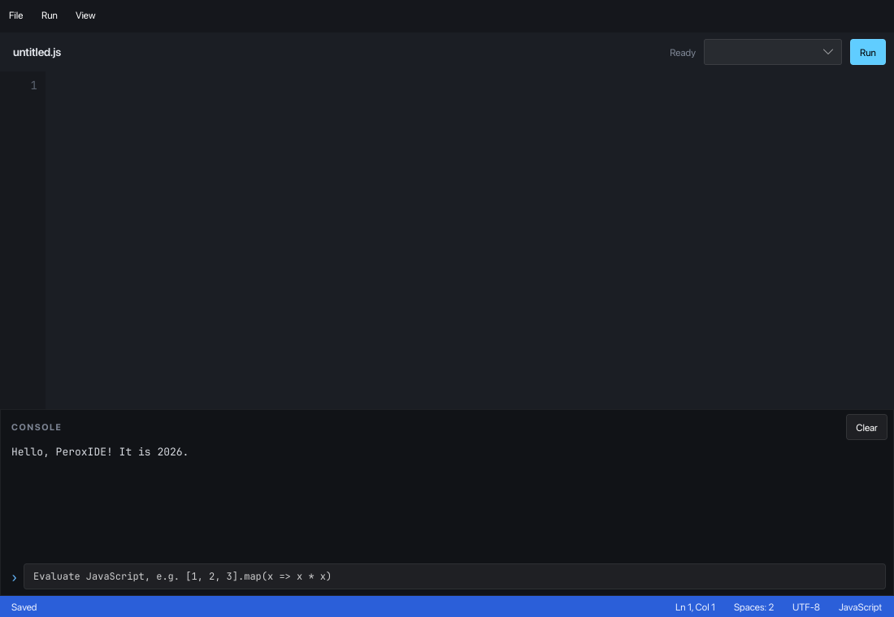

# Building JS Pad with PeroxIDE

How this sample was made: by an AI agent (Claude Code) driving PeroxIDE over its MCP
server, using only the IDE's own commands: 174 calls, from `project.new` to `build.fmt`.
The brief was "a simple Notepad-style text editor with a monospaced font, a console, and
highlighting for JavaScript". Three gaps turned up; each is below with its fix, made in
PeroxIDE first.

## 0. Highlighting in Slint: the plan

Slint colours text only in `StyledText`, which can't be edited. The usual answer: an
editable `TextInput` with transparent text over the same text drawn in colour. Slint's
`LineEdit` and `TextEdit` wrap a TextInput in their own frame and scrolling, with no way
to make the text transparent or to know where the caret is.

> **Gap 1: no bare TextInput in the palette.** **Fix:** `TextInput` is in the palette,
> with its colours (text, selection), `single-line`, `wrap`, `read-only`, and the
> `cursor-position-changed(position)` event.

Two more things learned from Slint's source before starting: a TextInput's caret is drawn
in its text colour (so a transparent text has no caret: the window draws its own), and
Tab moves the focus (so the editor handles it in `key-pressed`).

## 1. Project, font, data

```
project.new         { path: "P", template: "gui" }
designer.app_style  { style: "fluent", color_scheme: "dark" }
designer.add_resource { file: ".../JetBrainsMonoNL-Regular.ttf" }   // → family "JetBrains Mono NL"
```
The no-ligatures cut of JetBrains Mono, bundled: ligatures would merge characters and
break the column arithmetic, and a font every system has differs from system to system.

Two structs in the Source view: `Run { row, col, text, color }` (a highlighted run, or a
line number) and `ConsoleLine { text, color }`. Then the shared properties (`code`,
`runs`, `line_numbers`, `console`, the caret, the font size…), the callbacks, and the
actions the menus run:
```
designer.set_action { name: "run_code" }      // … new_file, open_file, save_file, save_as,
                                              //   clear_console, bigger, smaller, toggle_console
```

## 2. The window

Menus, each item an action with its shortcut:
```
designer.add_widget { parent: "#0.1", kind: "MenuItem", id: "run_code_item",
                      props: { title: "\"Run\"", shortcut: "@keys(Control + R)" } }
designer.use_action { widget: "run_code_item", action: "run_code" }
```
(`@keys(Control + Minus)` didn't compile: punctuation keys are written quoted,
`@keys(Control + "-")`.)

The editor: a `ScrollView` whose content holds the gutter, a band for the current line,
a `Text` per run (`for r in root.runs`, at `x: 68px + r.col * root.char_w`), the
TextInput, and the caret. The column width and line height are measured from the font by
two hidden `Text`s:
```
designer.declare_property { name: "char_w", type: "length", visibility: "out", default: "measure.preferred-width / 40" }
designer.add_widget { parent: "content", kind: "TextInput", id: "code",
                      props: { text: "<=> root.code", color: "transparent",
                               selection-foreground-color: "transparent", single-line: "false", … } }
```
The TextInput's events, in .slint: the caret follows `cursor-position-changed` and the
view scrolls to keep it in sight; Tab and Return go to Rust, which inserts the text and
says where the caret goes next:
```
designer.set_handler { widget: "code", event: "key-pressed", params: ["event"],
  code: "if event.text == Key.Tab && !event.modifiers.shift { root.indent(self.cursor-position-byte-offset);
         self.set-selection-offsets(root.caret_after, root.caret_after); return accept; } … return reject;" }
```
A `Timer` blinks the caret while the editor has focus. The console's height animates
open and shut (`designer.set_animation`), and it follows its output with a `changed`
handler: when its lines grow, it scrolls to the end.

The build warned that `viewport-width`, `viewport-height` and `viewport-y` are
deprecated: Slint 1.19 calls them `content-*`.

> **Gap 2: the palette offered deprecated names.** The inspector's ScrollView properties
> were `viewport-width` and `viewport-height`. **Fix:** `content-width` and
> `content-height`. (This file's uses were renamed in the Source view.)



## 3. The code

```
file.write { path: "src/js.rs", … }        // the tokenizer, with tests
file.write { path: "src/engine.rs", … }    // Boa and the console, with tests
file.write { path: "src/examples.rs", … }
file.write { path: "src/main.rs", … }
file.write { path: "Cargo.toml", … }       // boa_engine
build.test {}
```

> **Gap 3: no Open or Save dialog.** perox-ui had message boxes but nothing to pick a
> file. **Fix:** `perox_ui::files::open` and `save`, the system's own dialogs, over the
> window.

The first test run failed on the test, not the code: "every example runs without an
error" counted the Promises example's deliberate `console.error`. It now checks for
uncaught errors, and so does the status line after Run.

## 4. Look at it running

```
build.snapshot { out: "docs/app.png", args: ["--example", "Classes", "--run",
                 "--eval", "shapes.map(s => s.name)", "--eval", "Shape.count * 7"] }
```
The highlighting and the gutter came out as designed. Two things were off: the console
didn't show its last lines (its scroll position was estimated in Rust; now the `changed`
handler above does it exactly), and the run's header named `untitled.js` for an example.

Later, with the screen unlocked, it was typed into for real (keystrokes sent to the
running app: ⌘N, a function and a loop, ⌘R). Two things turned up:

- The editor didn't have the keyboard at start: the first key went to the toolbar.
  The window now forwards focus to it (`designer.set_property { widget: "#", name:
  "forward-focus", value: "code" }`).
- A `}` typed on a line of only indentation stayed indented, and the next line kept the
  indent. It now steps back a level (`close_brace`, tested as `dedent_brace`).

Then the typed program ran: `1 1`, `2 8`, `3 27`. The Open and Save dialogs weren't
tried this way.

## 5. Finish

```
build.clippy {}    // two warnings: an unused list (now the toolbar's), a derivable Default
build.fmt {}
```
Moved into the repository as `examples/js-pad`.

## Tools added for this

| Gap | Now |
|---|---|
| No bare TextInput | In the palette, with `cursor-position-changed` |
| Deprecated ScrollView names in the inspector | `content-width`, `content-height` |
| No Open or Save dialog | `perox_ui::files::{open, save}` |

Added just before, for this: TouchArea's `moved` and `pointer-event` in the inspector's
events.
