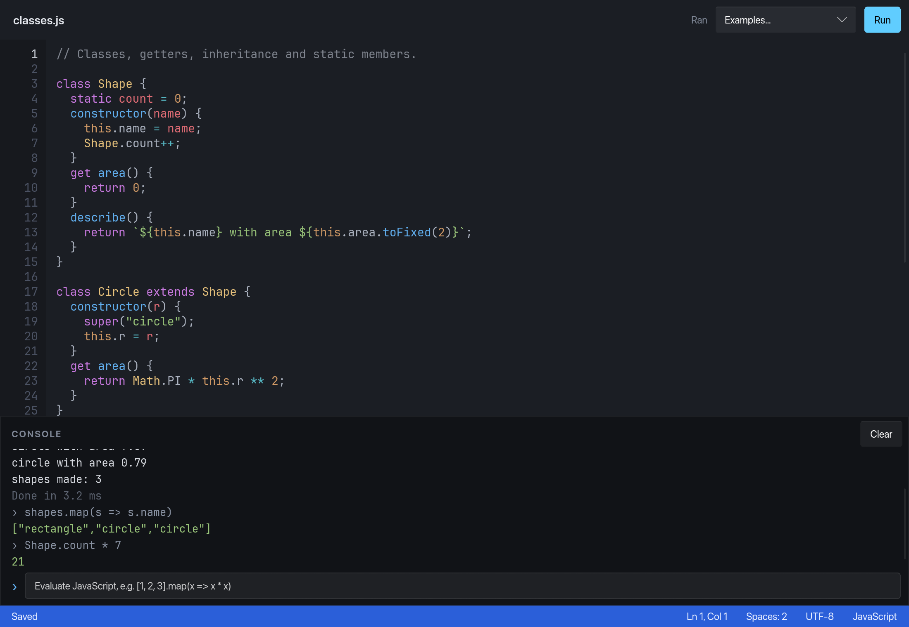
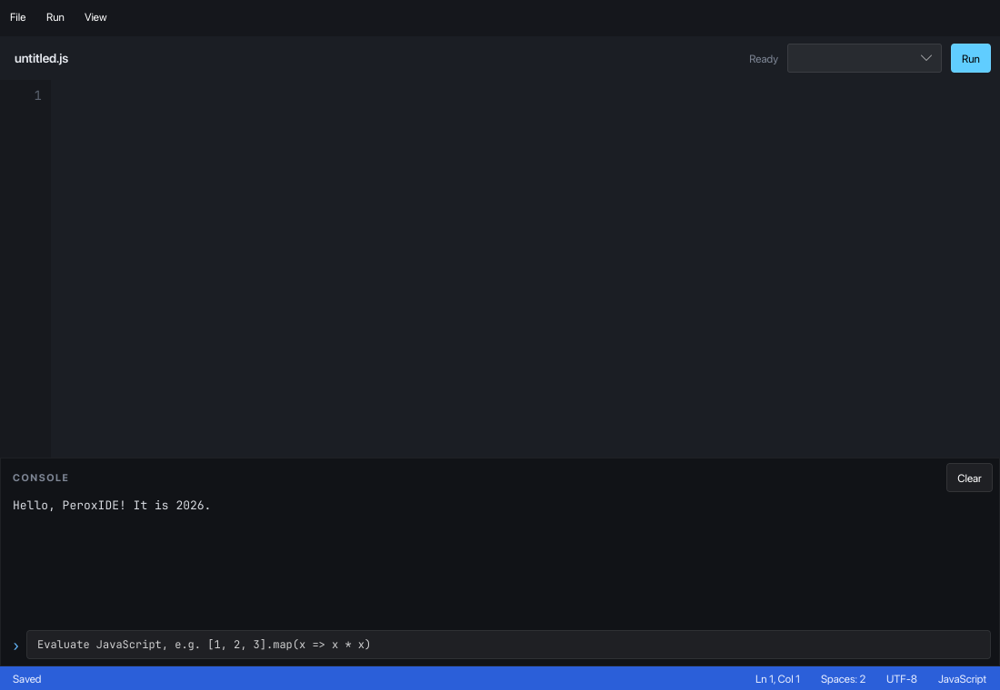
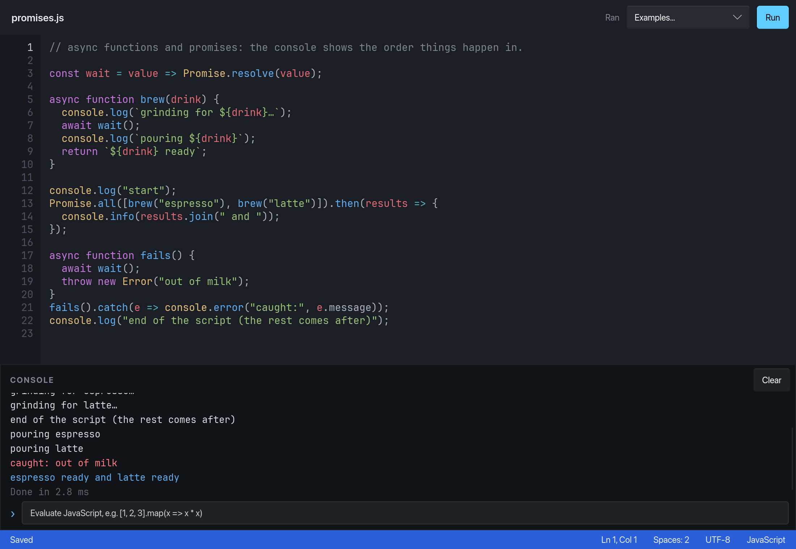

# JS Pad

A PeroxIDE sample: a small JavaScript editor in the spirit of Notepad, with a monospaced
font, syntax highlighting, and a console that runs your code.



- **The editor**: JetBrains Mono (bundled, so it looks the same everywhere), line numbers,
  the current line marked, Tab indents, Return keeps the indentation (one more after `{`),
  bigger and smaller text (⌘= / ⌘−; Ctrl on Windows and Linux). Undo, redo, selection and
  the clipboard work as in any text field.
- **Highlighting** as you type: keywords, strings and template literals (with their
  `${…}`), numbers, comments, regular expressions, function names, built-ins, properties.
- **Run** (⌘R) runs the file with [Boa](https://boajs.dev), a JavaScript engine written in
  Rust: `console.log`, `info`, `warn` and `error` in their colours, uncaught errors in red,
  promises and `async` functions. A runaway loop is stopped.
- **The console's input line** evaluates more JavaScript in the file's scope, so you can
  try things on what the file defined.
- **Files**: New, Open, Save, Save As (the system's dialogs), and a prompt before unsaved
  changes are thrown away. Five examples to start from.

It was built inside PeroxIDE by an AI agent (Claude Code) driving the IDE over MCP: the
window in the form designer, the code written, tested, run, linted and formatted through
the IDE. [BUILDING.md](BUILDING.md) is the record, with the gaps it found in PeroxIDE.

## Run it

```sh
cargo run -p js-pad                                  # from the PeroxIDE repository
cargo run -p js-pad -- path/to/script.js --run       # open a file and run it
cargo run -p js-pad -- --example Fibonacci --run
```

Or open this folder in PeroxIDE and press Run. Tests: `cargo test -p js-pad`.

## How it's put together

The editor is two layers in one `ScrollView`. On top, a **TextInput** holding the text,
its own text transparent: it does the typing, selecting, undo and the clipboard. Under it,
the same text drawn as coloured runs, one `Text` per run, placed by row and column (the
font is monospaced, so a column is a fixed width, measured from the font). Only the rows
in view are drawn. Slint draws a TextInput's caret in its text colour, so the caret is a
`Rectangle` of the window's own, moved by `cursor-position-changed` and blinked by a
`Timer`.

| File | What's in it |
|---|---|
| `ui/main_window.slint` | Menus (File, Run, View) running actions; the toolbar; the editor (gutter, current line, runs, TextInput, caret); the console, which slides open and follows its output; the status bar. |
| `src/js.rs` | The highlighter: a tokenizer for JavaScript, tokens by row and column, and the ones in view. |
| `src/engine.rs` | Boa with a `console` that writes to the panel; running a file; evaluating a line. |
| `src/examples.rs` | Hello, Fibonacci (recursion, a loop, a generator with BigInt), Classes, Sorting, Promises. |
| `src/main.rs` | `MainWindowHandlers`: editing (indent, Return), files, running, the console. |

| Designed in PeroxIDE | Promises: the order things happen in |
|---|---|
|  |  |

(In the designer the editor looks empty: the code and its colours come from Rust when the
app runs.)

Font: [JetBrains Mono](https://www.jetbrains.com/lp/mono/) (the no-ligatures cut, so
characters keep their columns), SIL Open Font License, `ui/fonts/OFL.txt`. JavaScript
engine: Boa (MIT or Unlicense). Licence: MIT OR Apache-2.0; a build you distribute uses
Slint under one of its licences (the About dialog carries the credit its free licence asks
for).
