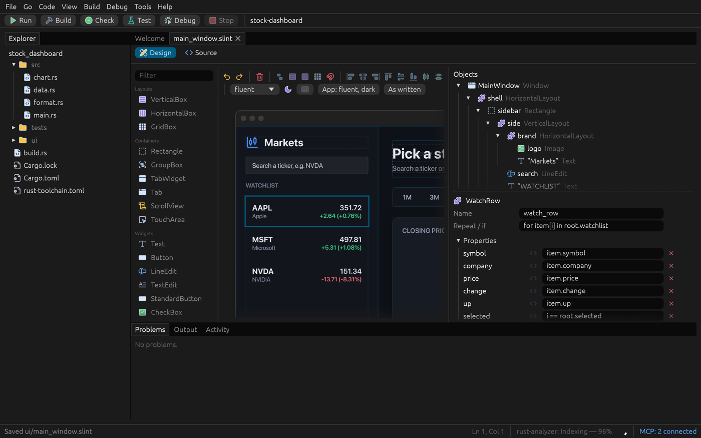
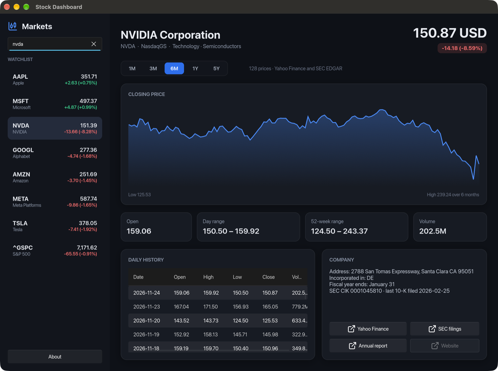

# Building Stock Dashboard with PeroxIDE

How this sample was made: by an AI agent (Claude Code) driving PeroxIDE over its MCP
server, using only the IDE's own commands (the ones its menus and designer run): about 220
calls, from `project.new` to `build.clippy`. The brief was the Stock Viewer's data in a UI
"as nice as Slint UIs typically look", made with the RAD tools only, adding tools where
they fell short. Seven did; each is below with its fix, made in PeroxIDE's own code before
carrying on.

The calls are shown shortened (`P` is the project folder, paths are relative to it).

## 1. Project and look

```
project.new         { path: "P", template: "gui" }
designer.app_style  { path: "ui/main_window.slint", style: "fluent", color_scheme: "dark" }
```
The template's window, About dialog and `build.rs`; the app always dark, Fluent on every OS.

## 2. The parts (New Component)

A design like this is made of a few parts used many times, so those came first, each with
`form.new { kind: "component" }` (File → New Component…), then its properties, then its
elements.

**Card**: a rounded, shadowed panel with an optional title, content inside.
```
form.new             { path: "ui/parts/card.slint", kind: "component" }
designer.set_property { widget: "#", name: "background",        value: "#171b23" }
designer.set_property { widget: "#", name: "border-radius",     value: "14px" }
designer.set_property { widget: "#", name: "drop-shadow-blur",  value: "20px" }   … border, shadow colour, offset
designer.set_header   { widget: "#0.0", header: "if root.title != \"\"" }          // title only when there is one
designer.add_widget   { parent: "#0", kind: "@children" }                         // where content goes
```
> **Gap 1: a component couldn't take content.** Slint marks where a component shows what's
> put inside it with `@children`; the designer had no way to add one, and didn't treat such
> a component as a container (you couldn't drop anything into a Card). **Fix:** a "Children
> go here" palette entry (and `kind: "@children"` over MCP) while designing a component;
> the parser records the slot; the palette's project components that have one accept
> children, laid out like the layout their slot sits in.

> **Gap 2: no `if` or `for`.** Slint makes an element conditional (`if cond : Elem {}`) or
> repeated (`for item in model : Elem {}`). The parser skipped them, so the designer didn't
> show them, and nothing could write them. **Fix:** they're elements now, with their header
> shown in the Objects tree and edited in a new *Repeat / if* row of the inspector;
> `designer.set_header` over MCP.

> **Gap 3: setting a component's own property duplicated it.** `title` is declared on the
> Card (`in property <string> title: "Card";`); setting it on the root added a second
> binding, which doesn't compile. **Fix:** setting (or resetting) a component's own
> property changes its declaration's default.

**StatTile**, a label and a value:
```
form.new                     { path: "ui/parts/stat_tile.slint", kind: "component" }
designer.remove_declaration  { name: "title" }
designer.declare_property    { name: "label", type: "string", default: "\"Label\"" }
designer.declare_property    { name: "value", type: "string", default: "\"—\"" }
designer.add_widget          { parent: "#0", kind: "Text", props: { text: "root.value", font-size: "18px", … } }
```
> **Gap 4: no way to declare a property or callback, or remove one.** The designer only
> declared them as a side effect (exposing a widget's property, wiring an event). A
> component needs its own `in` properties and its own events. **Fix:**
> `designer.declare_property`, `designer.declare_callback`, `designer.remove_declaration`,
> and a *Declared properties* section on the root in the inspector. (This also closes the
> Stock Viewer's open item: there was no way to remove a declaration.)

**Segmented**, the range picker: one pill per item, the picked one blue.
```
designer.declare_property  { name: "items",   type: "[string]", default: "[\"1M\", \"3M\", \"6M\", \"1Y\", \"5Y\"]" }
designer.declare_property  { name: "current", type: "int", visibility: "in-out", default: "0" }
designer.declare_callback  { name: "picked", params: [["index", "int"]] }
designer.add_widget        { parent: "#0", kind: "Rectangle", id: "pill",
                             props: { background: "i == root.current ? #2f6fec : pill_area.has-hover ? #ffffff10 : transparent", … } }
designer.set_header        { widget: "pill", header: "for item[i] in root.items" }
designer.add_widget        { parent: "pill", kind: "TouchArea", id: "pill_area" }
designer.set_handler       { widget: "pill_area", event: "clicked", code: "root.current = i; root.picked(i);" }
```
> **Gap 5: an event could only call Rust.** `set_handler` forwarded an event to a root
> callback, a Rust method. A part like this keeps its own behaviour (pick the pill, then
> tell the form). **Fix:** `set_handler` also takes `code`, `.slint` statements to run.

**WatchRow**, one stock: symbol and name on the left, price and change (green or red)
on the right, a highlight when selected or hovered, and `clicked`.


## 3. The window

Cleared the template's widgets and declarations, then declared what the window and the
Rust code share: the watchlist, the selected row, the stock's texts, the chart's two paths,
the link flags, and the callbacks `watch_clicked(index)`, `search_accepted(text)`,
`range_picked(index)`, `link_clicked(index)`.

The watchlist's row type is data, not something to draw, so it was typed in the Source
view (the only line written outside the designer):
```
editor.replace { path: "ui/main_window.slint", start_line: 2, …,
                 text: "export struct WatchItem { symbol: string, company: string, price: string, change: string, up: bool }" }
```
Icons from Lucide went in with `designer.add_resource` (copied to `ui/images/`).

Then the layout, all `designer.add_widget`: a sidebar (logo, search, the watchlist, About)
and the main column (header with price and change pill, the range picker, the chart card,
four stat tiles, history and company cards). The watchlist is one `WatchRow` per item:
```
designer.add_widget  { parent: "watch", kind: "WatchRow", id: "watch_row",
                       props: { symbol: "item.symbol", …, selected: "i == root.selected" } }
designer.set_header  { widget: "watch_row", header: "for item[i] in root.watchlist" }
designer.set_handler { widget: "watch_row", event: "clicked", code: "root.watch_clicked(i);" }
```
The chart is two `Path`s over the same view box: the area under the line, filled with a
gradient, and the line.
```
designer.add_widget { parent: "chart", kind: "Path", id: "chart_fill",
                      props: { commands: "root.chart_area", fill: "@linear-gradient(180deg, #4c8dff59 0%, #4c8dff00 100%)", … } }
designer.add_widget { parent: "chart", kind: "Path", id: "chart_stroke",
                      props: { commands: "root.chart_line", stroke: "#4c8dff", stroke-width: "2px", … } }
```
Dropping the project's parts imported them (`import { WatchRow } from "parts/watch_row.slint";`).
`designer.tree` reported no errors after each step; `designer.screenshot` showed the result.



## 4. The code

```
file.write { path: "src/data.rs",   … }   // Stock Viewer's, plus fetch_quote for the watchlist
file.write { path: "src/format.rs", … }   // Stock Viewer's
file.write { path: "src/chart.rs",  … }   // the line, and the area under it, with tests
file.write { path: "src/main.rs",   … }   // handlers, the watchlist loader, show()
file.write { path: "tests/fixtures/…" }   // saved responses for the parser tests
file.write { path: "Cargo.toml", … }      // serde_json, ureq, webbrowser
build.test {}                             // 12 passed, no warnings
build.run  {}
```
The generated `MainWindowHandlers` trait had one method per declared callback; the code
filled them in. It built the first time.

## 5. Look, fix, look again

The first run looked right except the chart, which sat in a thin band.

> **Gap 6: no way to stretch a path.** A `Path` keeps its view box's shape (1000 × 100)
> unless `fit` says otherwise, and the inspector didn't offer `fit`. **Fix:** `fit` in the
> inspector (contain, cover, fill, preserve). With `fit: fill` the chart fills its card.

The history table cut its dates short; `columns` got minimum widths.

In the designer, two things were off:

> **Gap 7: the inspector hid expressions.** The `WatchRow`'s `symbol: item.symbol` showed as
> an empty text field and `up: item.up` as an unticked checkbox, and typing there would
> have replaced the expression. **Fix:** a value that isn't a plain value of the property's
> type is shown and edited as source.

And the watchlist was empty while designing (its rows come from Rust). Giving the
`watchlist` declaration three sample rows as its default made the designer show real
looking rows; the app replaces them as it starts.

Search was checked by typing `NVDA` and Return into the running app (it loaded, the change
showed red, the watchlist highlight moved). Clicking rows and range pills wasn't driven by
automation; it goes through the same lookup as search.



## 6. Finish

```
build.clippy {}     // no warnings
build.fmt {}
```
Moved into the repository as `examples/stock-dashboard` (workspace dependencies instead of
paths), where it builds and tests with the workspace's stricter lints.

## Tools added for this

| Gap | Now |
|---|---|
| Components couldn't take content | "Children go here" (`@children`); such components accept drops |
| No `for` / `if` | They're elements; *Repeat / if* in the inspector; `designer.set_header` |
| Setting a component's own property duplicated it | Changes the declaration's default |
| No declaring or removing properties and callbacks | *Declared properties*; `designer.declare_property`, `declare_callback`, `remove_declaration` |
| Events could only call Rust | `designer.set_handler { code }` |
| No `fit` for paths | In the inspector |
| Expressions shown as empty values | Shown and edited as source |

Added just before, for this kind of design: drop shadows, clipping and opacity in the
inspector, and a gradient editor for colours.
