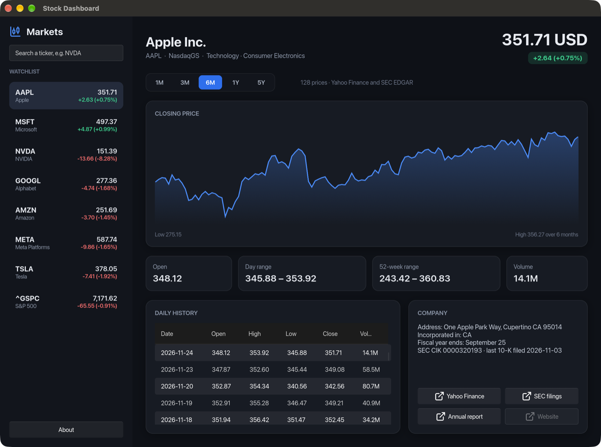
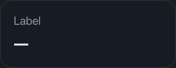
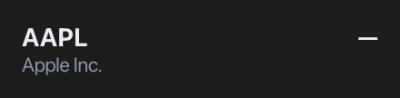
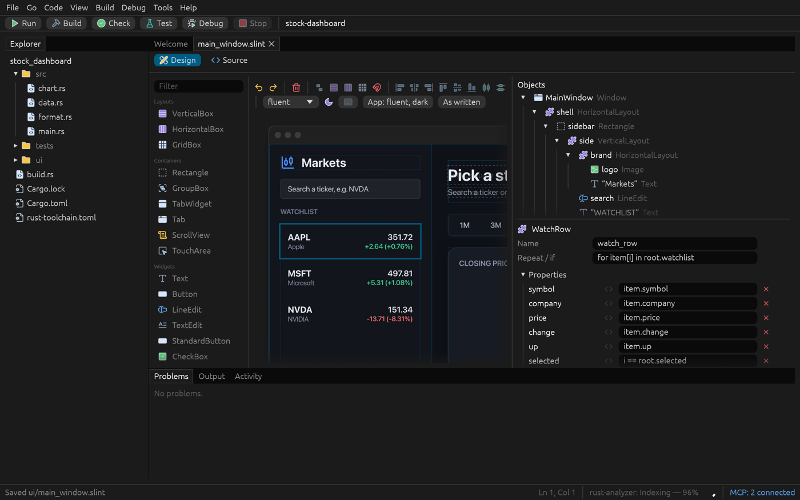
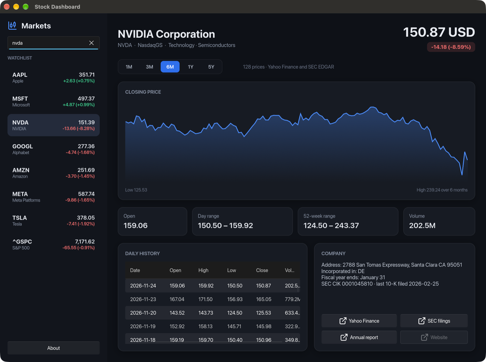

# Stock Dashboard

A PeroxIDE sample: the [Stock Viewer](../stock-viewer) again, redesigned the way Slint apps
usually look. Dark, with rounded cards, a sidebar watchlist with live prices, a filled price
chart and stat tiles.



- **Watchlist**: Apple, Microsoft, NVIDIA, Alphabet, Amazon, Meta, Tesla and the S&P 500,
  with their latest price and the day's change, green or red. Click one to show it.
- **Search**: type any ticker and press Return.
- **Chart**: closing prices over 1 month to 5 years, with the area under the line filled,
  and the range's low and high.
- **The day's numbers**: open, day range, 52-week range, volume.
- **Daily history** (weekly for 5 years), newest first.
- **Company**: address, incorporation, fiscal year, latest annual report, and links to Yahoo
  Finance, the SEC filings, the annual report and the company's website (greyed out when
  there's nowhere to go).

It was built entirely inside PeroxIDE by an AI agent (Claude Code) driving the IDE over
MCP: the parts and the window were made in the form designer, and the code was written,
built, tested, formatted and linted through the IDE. [BUILDING.md](BUILDING.md) is the
record, including the seven gaps in the tools it found and how they were fixed.

## Run it

```sh
cargo run -p stock-dashboard            # from the PeroxIDE repository
cargo run -p stock-dashboard -- AMD     # start on another ticker
```

Or open this folder in PeroxIDE and press Run. Tests (offline): `cargo test -p stock-dashboard`.

## How it's put together

The window is made of four components, each made in the designer as a **New Component**
and dropped onto the window from the palette:

| Part | What it is | |
|---|---|---|
| `ui/parts/card.slint` | A rounded, shadowed panel with an optional title; what you put inside it goes under the title (`@children`). | |
| `ui/parts/stat_tile.slint` | A label and a value. |  |
| `ui/parts/segmented.slint` | A row of pills, one picked: one per item (`for item[i] in root.items`), raising `picked(index)`. |  |
| `ui/parts/watch_row.slint` | One watchlist row, highlighted when selected or hovered, raising `clicked`. |  |

| File | What's in it |
|---|---|
| `ui/main_window.slint` | The window: a `WatchRow` per watchlist item, the header, the range `Segmented`, the chart `Card` (two `Path`s: a gradient-filled area and the line), four `StatTile`s, the history and company cards. Properties and callbacks the Rust code uses are declared at the top. |
| `ui/slint-project.json` | The app's look: Fluent, always dark (PeroxIDE's App Style). |
| `src/main.rs` | `MainWindowHandlers`, the watchlist loader, and `show`, which puts a lookup into the window. Lookups run on a thread; an older one that finishes late is ignored. |
| `src/data.rs`, `src/format.rs` | From Stock Viewer: fetching from Yahoo Finance and SEC EDGAR (no API key), parsing, formatting; plus `fetch_quote` for the watchlist. |
| `src/chart.rs` | Closing prices → path commands for the line, and the same closed along the bottom for the area. |

| Designed in PeroxIDE | NVIDIA, down on the day |
|---|---|
|  |  |

Data: the same free services as Stock Viewer (Yahoo Finance's chart and search APIs, SEC
EDGAR), public but unofficial for this use; see [Stock Viewer's notes](../stock-viewer/README.md#data).
Icons: [Lucide](https://lucide.dev) (ISC). Licence: MIT OR Apache-2.0; a build you distribute
uses Slint under one of its licences (the About dialog carries the credit its free licence
asks for).
