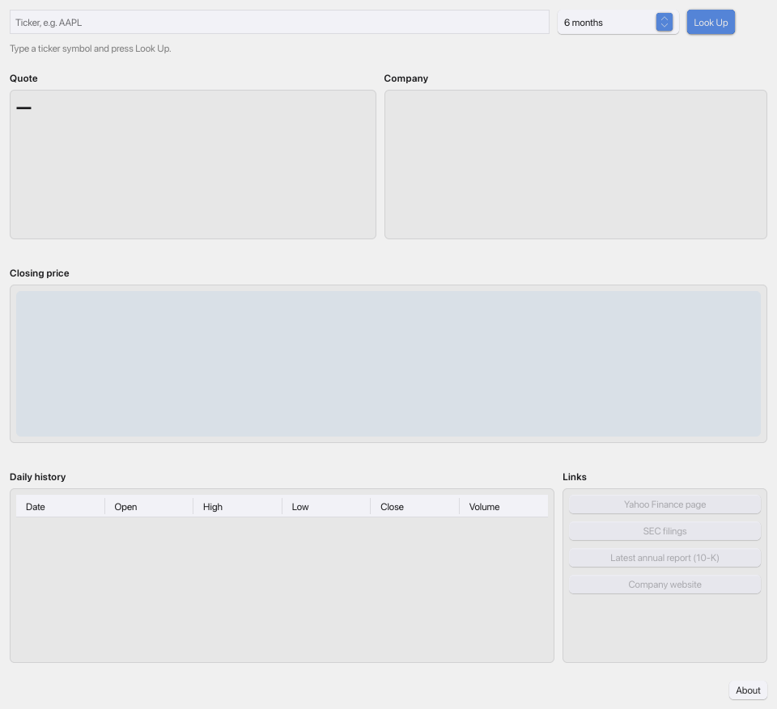
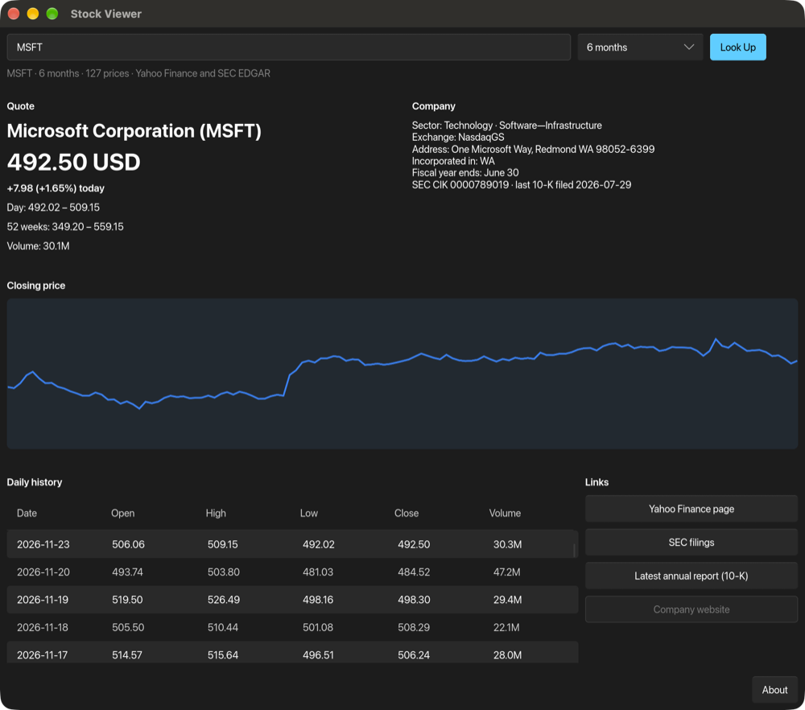
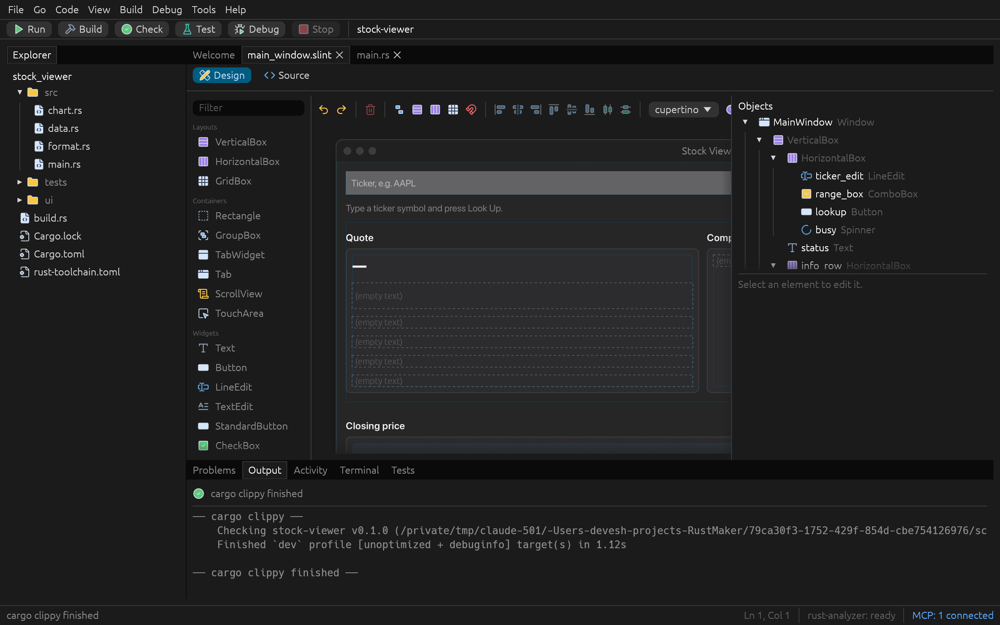

# Building Stock Viewer with PeroxIDE

How this sample was made: by an AI agent (Claude Code) driving PeroxIDE over its MCP
server, using the IDE's own commands (the same ones its menus run) for the project, the
form designer, editing, building and running. It's also a test of the tools: every gap
we hit is listed with what we did about it.

## 0. Choosing the data (before touching the IDE)

Free, no API key:

| Need | Source |
|---|---|
| Quote and daily history | Yahoo Finance chart API `query1.finance.yahoo.com/v8/finance/chart/<T>?range=6mo&interval=1d` |
| Sector, industry | Yahoo Finance search `query1.finance.yahoo.com/v1/finance/search?q=<T>` |
| Ticker → SEC company id (CIK) | SEC EDGAR full-text search index `efts.sec.gov/LATEST/search-index?keysTyped=<T>` |
| Address, incorporation, filings | SEC EDGAR `data.sec.gov/submissions/CIK##########.json` |

SEC's `company_tickers.json` refuses clients that don't send a contact email in their
User-Agent; the search index doesn't, so the app uses that instead.

## 1. New project

```
project.new { path: ".../stock_viewer", template: "gui" }
```
The GUI template: a Slint window, an About dialog, `build.rs`, `MainWindowHandlers`.

## 2. Designing the window (designer commands)

Cleared the template's greeting widgets:
```
designer.remove_widget { path: "ui/main_window.slint", widget: "#0.2" }    // greeting text
designer.remove_widget { ..., widget: "#0.0" }                              // "What's your name?"
designer.remove_widget { ..., widget: "greet" }
designer.remove_widget { ..., widget: "name_edit" }
designer.set_property  { ..., widget: "#", name: "preferred-width",  value: "960px" }
designer.set_property  { ..., widget: "#", name: "preferred-height", value: "720px" }
designer.set_property  { ..., widget: "#0", name: "alignment", value: null }   // removes it
```
**Gap found:** removing `name_edit` left `in-out property <string> name <=> name_edit.text;`
behind, which no longer compiles (designer.tree reported `Cannot access id 'name_edit'`).

Search row, status line:
```
designer.add_widget { parent: "#0.0", kind: "LineEdit", id: "ticker_edit",
                      props: { placeholder-text: "\"Ticker, e.g. AAPL\"", horizontal-stretch: "1" } }
designer.add_widget { parent: "#0.0", kind: "ComboBox", id: "range_box",
                      props: { model: "[\"1 month\", \"3 months\", \"6 months\", \"1 year\", \"5 years\"]", current-index: "2" } }
designer.add_widget { parent: "#0.0", kind: "Button", id: "lookup", props: { text: "\"Look Up\"", primary: "true" } }
designer.add_widget { parent: "#0.0", kind: "Spinner", id: "busy", props: { indeterminate: "true", visible: "false" } }
designer.add_widget { parent: "#0", index: 1, kind: "Text", id: "status", props: { text: "\"Type a ticker…\"", color: "#808080" } }
```
Quote and Company panels:
```
designer.add_widget { parent: "#0", index: 2, kind: "HorizontalBox", id: "info_row", props: { padding: "0px" } }
designer.add_widget { parent: "info_row", kind: "GroupBox", id: "quote_box",   props: { title: "\"Quote\"",   horizontal-stretch: "1" } }
designer.add_widget { parent: "info_row", kind: "GroupBox", id: "company_box", props: { title: "\"Company\"", horizontal-stretch: "1" } }
designer.add_widget { parent: "quote_box",   kind: "VerticalBox", id: "quote_lines",   ... }
designer.add_widget { parent: "company_box", kind: "VerticalBox", id: "company_lines", ... }
designer.add_widget { parent: "quote_lines", kind: "Text", id: "company_name", props: { font-size: "22px", font-weight: "700" } }
   … price (28px bold), change, day_range, year_range, volume
designer.add_widget { parent: "company_lines", kind: "Text", id: "sector", props: { wrap: "word-wrap" } }
   … exchange, address, incorporated, fiscal_year, cik
```
Chart, history table and links:
```
designer.add_widget { parent: "#0", index: 3, kind: "GroupBox", id: "chart_box", props: { title: "\"Closing price\"", vertical-stretch: "1" } }
designer.add_widget { parent: "chart_box", kind: "Rectangle", id: "chart_area", props: { min-height: "180px", border-radius: "6px", background: "#5fa8ec18" } }
designer.add_widget { parent: "chart_area", kind: "Path", id: "chart_line",
                      props: { width: "parent.width", height: "parent.height", viewbox-width: "1000", viewbox-height: "100",
                               stroke: "#3b82f6", stroke-width: "2px", commands: "\"\"" } }
designer.add_widget { parent: "#0", index: 4, kind: "HorizontalBox", id: "bottom_row", ... }
designer.add_widget { parent: "bottom_row", kind: "GroupBox", id: "history_box", props: { title: "\"Daily history\"", horizontal-stretch: "3" } }
designer.add_widget { parent: "history_box", kind: "StandardTableView", id: "history_table",
                      props: { columns: "[{ title: \"Date\" }, { title: \"Open\" }, … { title: \"Volume\" }]" } }
designer.add_widget { parent: "bottom_row", kind: "GroupBox", id: "links_box", props: { title: "\"Links\"" } }
designer.add_widget { parent: "links_box", kind: "VerticalBox", id: "link_list", ... }
designer.add_widget { parent: "link_list", kind: "Button", id: "yahoo_link", props: { text: "\"Yahoo Finance page\"", enabled: "false" } }
   … sec_link, filing_link, website_link
```
**Gap found:** `StandardTableView` and `Path` weren't in the palette, and the table wasn't
imported from `std-widgets.slint` ("Unknown element 'StandardTableView'").

## 3. Fixing the tools (in PeroxIDE's own code)

The point of the exercise, so they were fixed on the spot, each with a test:

| Gap | Fix |
|---|---|
| Removing a widget left `in-out property … <=> widget.prop` behind | `remove_element` also removes root properties aliasing anything in the removed subtree |
| `StandardTableView` not imported; not in the palette | Palette gains **StandardTableView** (columns, rows, current row; row and sort events) and **Path** (commands, stroke, fill, view box), with icons; other std-widgets (`ListView`, `AboutSlint`, pickers) are imported when added by name |
| Table rows couldn't be "used from code" (no type for `[[StandardListViewItem]]`) | Properties can carry a Slint type (`Data`), so `rows` and `columns` can be exposed |
| `Path.commands` can't be aliased (Slint: "can only be used to make a binding") | "Use from code" on such a property declares `in-out property <string> chart_line_commands: <old value>;` and binds `commands: root.chart_line_commands;`; turning it off gives the value back |

With the fixed IDE running, the table was removed and added again (now imported), and
the template's leftovers were deleted with one text edit, since there's no designer
command for removing a property or callback declaration (**gap, still open**):
```
editor.replace { path: "ui/main_window.slint", start_line: 9, end_line: 14, text: "" }
```

## 4. Using the widgets from code

```
designer.expose { widget: "ticker_edit",  name: "text" }           → get_ticker_edit_text()
designer.expose { widget: "range_box",    name: "current-index" }
designer.expose { widget: "busy",         name: "visible" }
designer.expose { widget: "status",       name: "text" }
designer.expose { widget: "company_name", name: "text" }   … price, change, day_range, year_range, volume
designer.expose { widget: "chart_line",   name: "commands" }      → bound, see above
designer.expose { widget: "history_table", name: "rows" }         → [[StandardListViewItem]]
designer.expose { widget: "yahoo_link",   name: "enabled" }  … sec_link, filing_link, website_link
```
Events, with "Go to handler" (wires the event to a root callback and adds a typed method
to `impl MainWindowHandlers for App` in `src/main.rs`):
```
designer.go_to_handler { widget: "lookup",       event: "clicked" }    → fn lookup_clicked(&mut self, ui: &MainWindow)
designer.go_to_handler { widget: "ticker_edit",  event: "accepted" }   → fn ticker_edit_accepted(…, text: SharedString)
designer.go_to_handler { widget: "range_box",    event: "selected" }   → fn range_box_selected(…, current_value: SharedString)
designer.go_to_handler { widget: "yahoo_link",   event: "clicked" }    … sec_link, filing_link, website_link
designer.set_property  { widget: "range_box", name: "width", value: "150px" }
designer.screenshot    { path: "ui/main_window.slint" }                 → docs/designed-form.png
```
**Gap found:** the template's `greet_clicked` method stayed in `main.rs` after its
callback was gone. Harmless here (`main.rs` was rewritten), but the designer could offer
to remove a handler whose callback no longer exists.



## 5. Writing the code

```
terminal.run { command: "cargo add ureq serde_json webbrowser" }
file.write   { path: "src/data.rs",   … }   // fetching and parsing, with tests
file.write   { path: "src/chart.rs",  … }   // closing prices → path commands, with tests
file.write   { path: "src/format.rs", … }   // money, volume, change, dates, with tests
file.write   { path: "src/main.rs",   … }   // the handlers, filling in the generated stubs
```
Test fixtures (`tests/fixtures/*.json`) are trimmed real responses from each service.

## 6. Build, test, fix

```
build.build      → 0 errors, 0 warnings, first time
test.run         → 11 passed, 1 failed: chart::tests::flat_and_short_series
```
The Test Explorer showed the failure and where it panicked: a flat price series drew
along the top edge instead of the middle. Fixed in `chart.rs`, then:
```
test.run { failed: true }   → 12 passed
```

## 7. Run, look, improve

```
terminal.run { command: "cargo run -q -- AAPL" }
```
`stock-viewer TICKER` looks the ticker up at start: added so the running app could be
seen with data, and handy anyway. Screenshots of the real window (Apple, Microsoft, the
S&P 500 index, an unknown ticker) showed one problem: with an index, the company panel
had gaps where facts were missing (empty labels still take space). The six company labels
became one multi-line label:
```
designer.remove_widget { widget: "sector" }  … exchange, address, incorporated, fiscal_year, cik
designer.add_widget    { parent: "company_lines", kind: "Text", id: "company_details", props: { wrap: "word-wrap" } }
designer.expose        { widget: "company_details", name: "text" }
```
Removing them also removed their six exposed properties: the first fix at work.

Finally:
```
build.fmt      → formatted
build.clippy   → no lints
editor.replace → a doc comment the shell had mangled
```



## What wasn't checked by hand

The link buttons' URLs are unit tested and the buttons enable only when there's a
target, but nobody clicked them during the build: macOS wouldn't let the automation
click inside another app's window. Opening goes through the `webbrowser` crate.

## By the numbers

- The window: 29 elements placed (plus the template's About button), 7 events wired with Go to handler, 17 properties used
  from code. All through designer commands, plus one text edit for template leftovers.
- The generated glue (`MainWindowHandlers`, `connect`, getters and setters) was never
  touched by hand.
- 4 tool gaps fixed in PeroxIDE along the way, 2 noted for later.
- 840 lines of Rust (with tests and docs), 166 lines of `.slint`.


