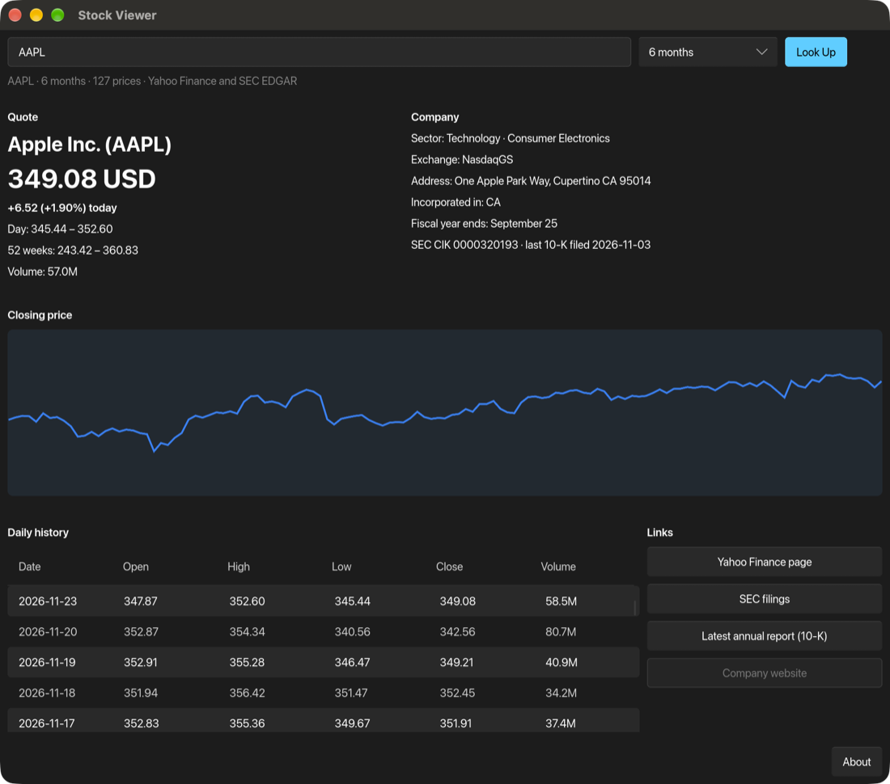
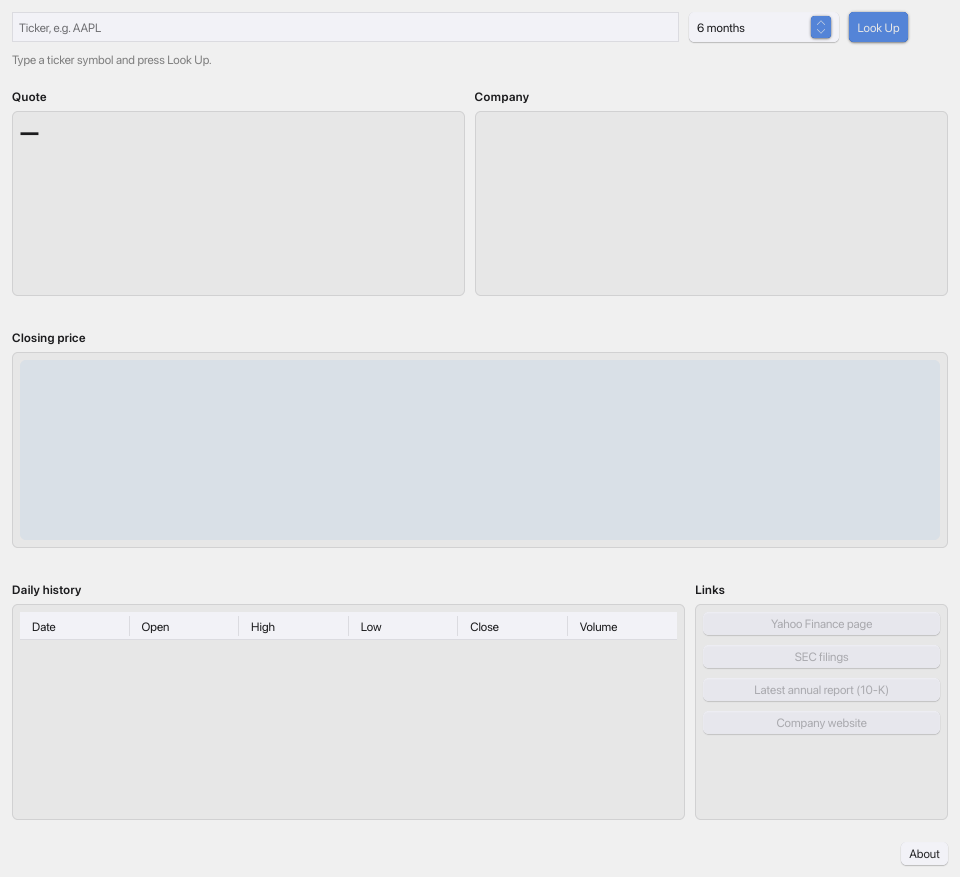
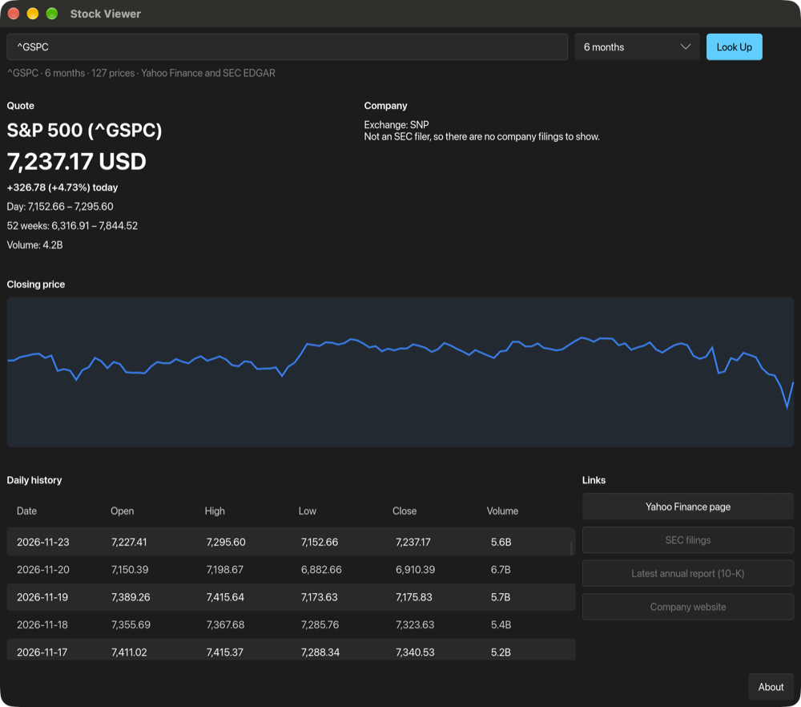
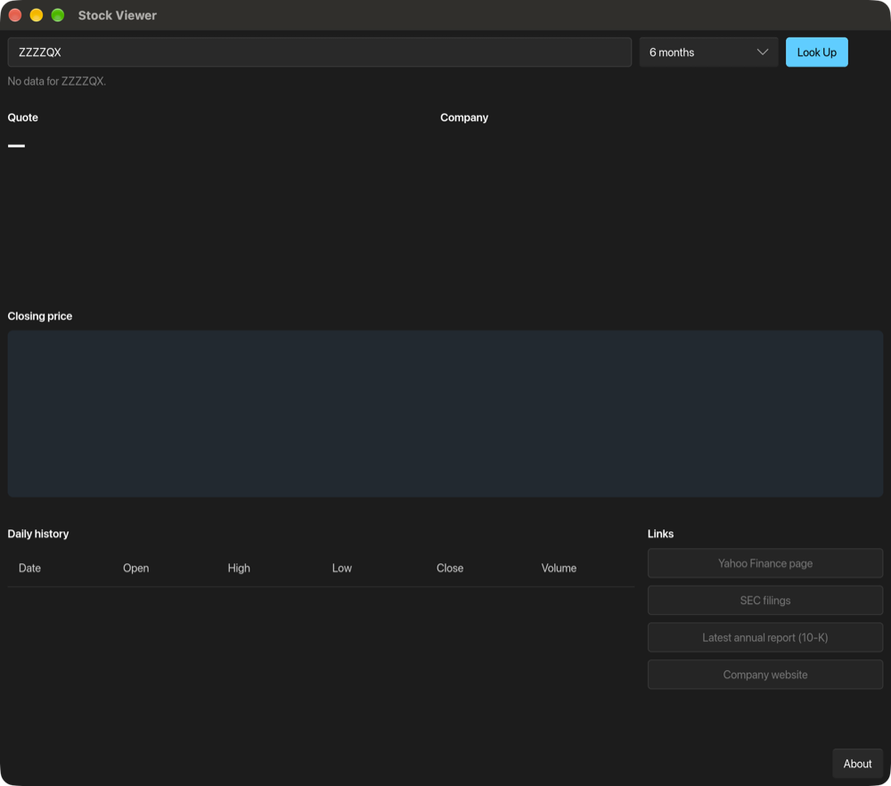

# Stock Viewer

A PeroxIDE sample app. Type a ticker (`AAPL`, `MSFT`, `^GSPC`…) and see:

- the **quote**: price, today's change, the day's and 52-week ranges, volume;
- a **chart** of closing prices over 1 month to 5 years;
- the **daily history** (weekly for 5 years) in a table, newest first;
- **company details** from SEC EDGAR: sector and industry, address, where it's
  incorporated, fiscal year end, the latest annual report;
- **links** to the Yahoo Finance page, the SEC filings list, the latest 10-K and the
  company website, opened in your browser. A link is greyed out when there's nowhere for it
  to go.



It was built entirely inside PeroxIDE by an AI agent (Claude Code) driving the IDE over
MCP. The window was made in the form designer, and the code was written, built, tested,
formatted and linted through the IDE. [BUILDING.md](BUILDING.md) is the full record,
including the gaps in the tools it found and how they were fixed.

## Run it

```sh
cargo run -p stock-viewer            # from the PeroxIDE repository
cargo run -p stock-viewer -- MSFT    # look a ticker up straight away
```

Or open this folder in PeroxIDE and press Run. Tests (offline, against saved responses):
`cargo test -p stock-viewer`.

## Data

Free services that need no API key:

| What | Source |
|---|---|
| Quote, prices | Yahoo Finance chart API |
| Sector, industry | Yahoo Finance search |
| Ticker → SEC company id (CIK) | SEC EDGAR search index |
| Address, incorporation, filings | SEC EDGAR submissions |

These are public but unofficial for this use: Yahoo can change or rate-limit its API,
and SEC asks automated clients to stay under 10 requests a second (a lookup makes 4
requests in all). Indexes, funds and foreign listings have prices but no SEC filings;
the app says so instead of showing empty fields.

## How it's put together

| File | What's in it |
|---|---|
| `ui/main_window.slint` | The window, from the designer. Properties the code sets are "used from code" (`in-out property … <=> element.prop`); events forward to root callbacks. |
| `src/main.rs` | `MainWindowHandlers`: the event handlers. A lookup runs on a background thread and hands its result to the UI thread with `upgrade_in_event_loop`; an older lookup that finishes late is ignored. |
| `src/data.rs` | Fetching (`ureq`) and parsing the four services' JSON into `Quote`, `Bar`s and `Company`; builds the links. |
| `src/chart.rs` | Closing prices → SVG path commands for the chart's `Path` element. |
| `src/format.rs` | Prices, volumes, changes, dates as text (no date library needed). |
| `tests/fixtures/` | Saved responses from each service, for the parser tests. |

| Designed in PeroxIDE | Index (no SEC filings) | Unknown ticker |
|---|---|---|
|  |  |  |

Licence: MIT OR Apache-2.0, like the rest of PeroxIDE's samples. The app uses Slint, so
a build you distribute follows one of Slint's licences (the About dialog carries the
credit its free licence asks for).
